# ComfyTV 节点使用教程

这篇文档按菜单里的分类，逐个说明 ComfyTV 的节点怎么用。每个节点下面的图是它在画布上的卡片：
左侧圆点是接进来的端口，右侧圆点是送出去的端口，中间是卡片上的控件。颜色对应数据类型。

| 颜色 | 数据类型 |
|---|---|
| 紫色 | 文本 `COMFYTV_TEXT` |
| 绿色 | 图片 `COMFYTV_IMAGE` |
| 蓝色 | 图片组 `COMFYTV_IMAGES` |
| 粉色 | 视频 `COMFYTV_VIDEO` |
| 黄色 | 音频 `COMFYTV_AUDIO` |
| 青色 | 3D 模型 `COMFYTV_MODEL` |

先记住三件事：

1. **运行只跑当前节点。** 卡片里的运行按钮不会重跑整张图，下游用的是上游已经保存的结果。
2. **很多节点不用运行。** 裁剪、旋转、调色滑杆、全景视角、图层和乐谱编辑都在浏览器里即时生效。
3. **要接 ComfyUI 原生节点，先过桥。** `COMFYTV_*` 是项目里的结果，原生 `IMAGE` / `VIDEO` / `AUDIO` 是运行时数据，用「桥接」分类里的节点互转。

共 211 个节点。

## 项目

先放一个项目节点，给这张画布起名。后面生成的图片、视频、音频都会归档到它下面。

### Project

给当前画布命名并切换项目，之后生成的所有结果都归档在这个项目下。

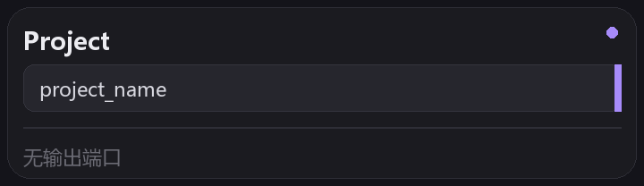

**卡片上的控件：** `project_name`

**送出去：** 无。

节点 ID：`ComfyTV.ProjectStage`

## 输入与加载

把已有的图片、视频、音频、文字、模型和 PSD 送进画布。加载后不用点运行，下游可以直接用。

### Layer Editor

图层编辑器：画形状、排文字、调图层，并导出成图片。

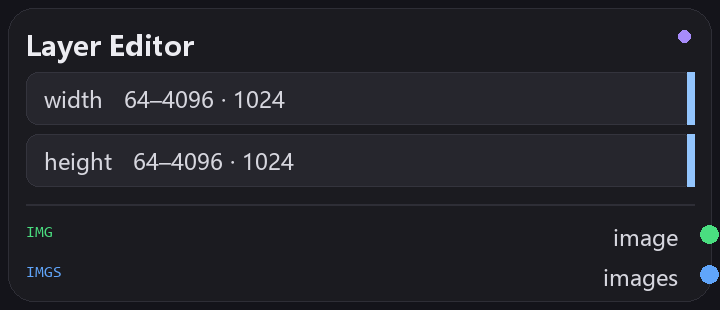

**卡片上的控件：** `width`（默认 `1024`；范围 `64`–`4096`）、`height`（默认 `1024`；范围 `64`–`4096`）

**送出去：** `image`（`COMFYTV_IMAGE`）、`images`（`COMFYTV_IMAGES`）

节点 ID：`ComfyTV.LayerEditorStage`

### Input Text

手写或粘贴一段文字，供下游提示词引用。

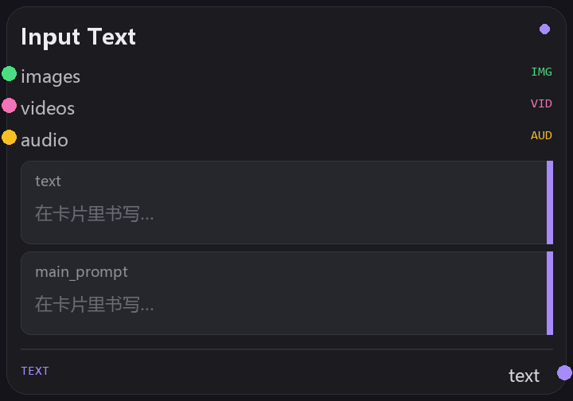

**接进来：** `images`（最多 9 路 `COMFYTV_IMAGE`）、`videos`（最多 4 路 `COMFYTV_VIDEO`）、`audio`（最多 3 路 `COMFYTV_AUDIO`）

**卡片上的控件：** `text`、`main_prompt`

**送出去：** `text`（`COMFYTV_TEXT`）

节点 ID：`ComfyTV.TextLoaderStage`

### Load Image

从本机文件加载一张图片，作为后续节点的输入。

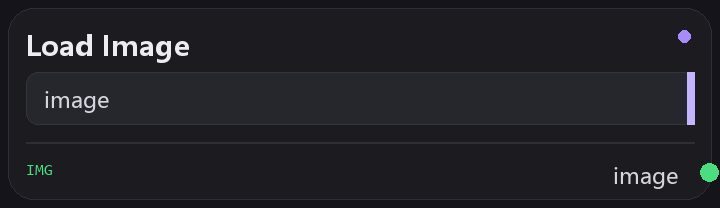

**卡片上的控件：** `image`（可选）

**送出去：** `image`（`COMFYTV_IMAGE`）

节点 ID：`ComfyTV.ImageLoaderStage`

### Load Image from Asset

从项目资产库里挑选一张图片。

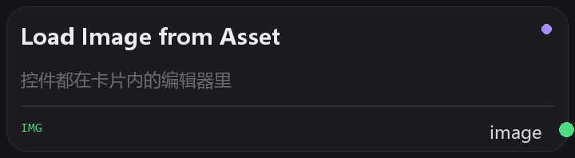

**送出去：** `image`（`COMFYTV_IMAGE`）

节点 ID：`ComfyTV.AssetImageLoaderStage`

### Load Video from Asset

从项目资产库里挑选一段视频。

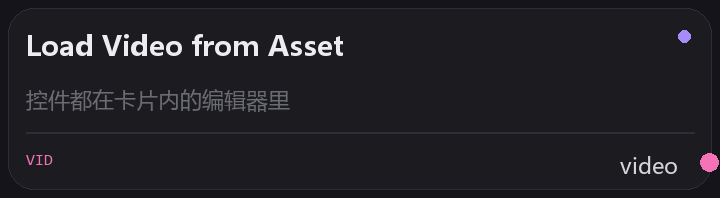

**送出去：** `video`（`COMFYTV_VIDEO`）

节点 ID：`ComfyTV.AssetVideoLoaderStage`

### Load Audio from Asset

从项目资产库里挑选一段音频。

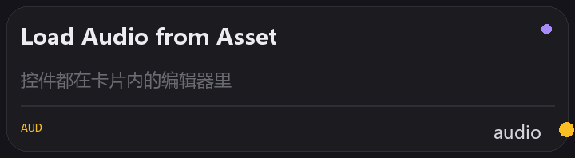

**送出去：** `audio`（`COMFYTV_AUDIO`）

节点 ID：`ComfyTV.AssetAudioLoaderStage`

### Load Text from Asset

从项目资产库里挑选一段文字。

**送出去：** `text`（`COMFYTV_TEXT`）

节点 ID：`ComfyTV.AssetTextLoaderStage`

### Load 3D Model from Asset

从项目资产库里挑选一个 3D 模型。

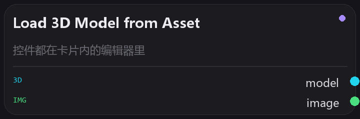

**送出去：** `model`（`COMFYTV_MODEL`）、`image`（`COMFYTV_IMAGE`）

节点 ID：`ComfyTV.AssetModelLoaderStage`

### Load 3D Model

加载一个 3D 模型文件，可在卡片里旋转查看。

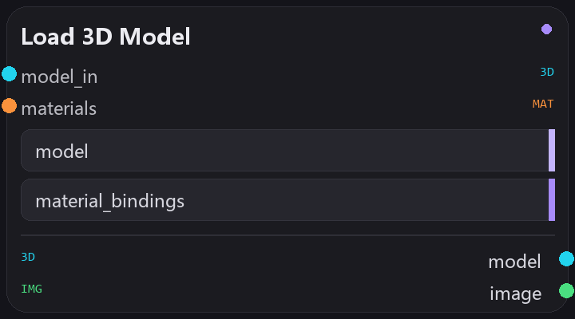

**接进来：** `model_in`（`COMFYTV_MODEL`）、`materials`（最多 4 路 `COMFYTV_MATERIAL`）

**卡片上的控件：** `model`（可选）、`material_bindings`

**送出去：** `model`（`COMFYTV_MODEL`）、`image`（`COMFYTV_IMAGE`）

节点 ID：`ComfyTV.ModelLoaderStage`

### Load Video

从本机文件加载一段视频。

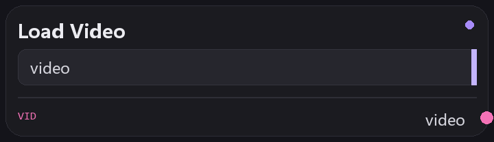

**卡片上的控件：** `video`（可选）

**送出去：** `video`（`COMFYTV_VIDEO`）

节点 ID：`ComfyTV.VideoLoaderStage`

### Load Audio

从本机文件加载一段音频。

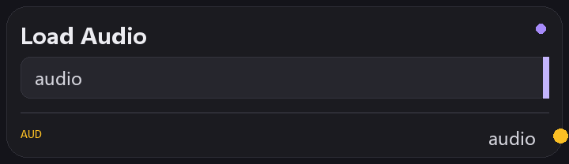

**卡片上的控件：** `audio`（可选）

**送出去：** `audio`（`COMFYTV_AUDIO`）

节点 ID：`ComfyTV.AudioLoaderStage`

### PSD Layer Tree

读入 PSD，保留图层结构供图层编辑器继续改。

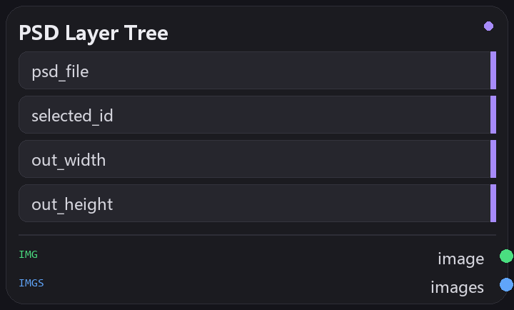

**卡片上的控件：** `psd_file`、`selected_id`、`out_width`、`out_height`

**送出去：** `image`（`COMFYTV_IMAGE`）、`images`（`COMFYTV_IMAGES`）

节点 ID：`ComfyTV.PsdLayerTreeStage`

### Material

调一个 PBR 材质球，供模型部件使用。

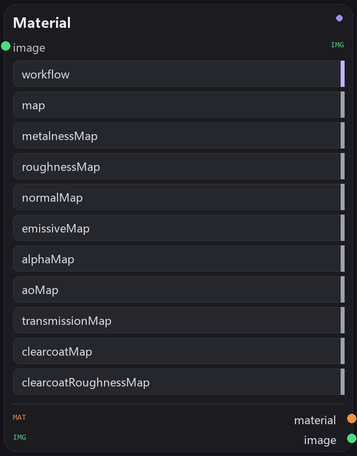

**接进来：** `image`（`COMFYTV_IMAGE`）

**卡片上的控件：** `workflow`、`map`、`metalnessMap`、`roughnessMap`、`normalMap`、`emissiveMap`、`alphaMap`、`aoMap`、`transmissionMap`、`clearcoatMap`、`clearcoatRoughnessMap`

**送出去：** `material`（`COMFYTV_MATERIAL`）、`image`（`COMFYTV_IMAGE`）

节点 ID：`ComfyTV.MaterialStage`

### Relight

重新给画面打光，改变光源方向和强弱。

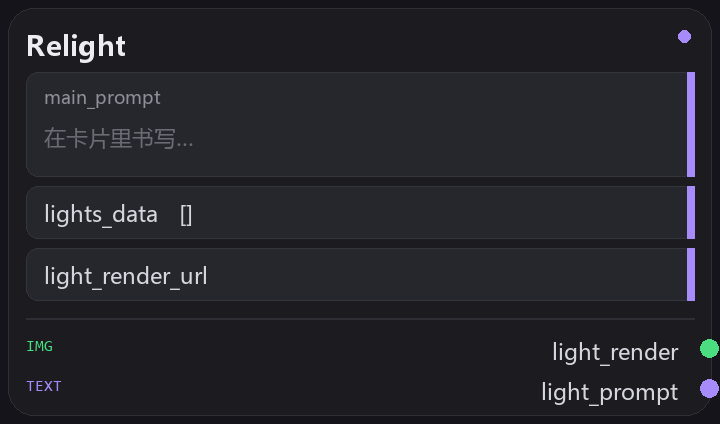

**卡片上的控件：** `main_prompt`、`lights_data`（默认 `[]`）、`light_render_url`

**送出去：** `light_render`（`COMFYTV_IMAGE`）、`light_prompt`（`COMFYTV_TEXT`）

节点 ID：`ComfyTV.RelightStage`

### 3D Scene

三维场景：摆放模型、相机和灯光，并可输出静帧或视频。

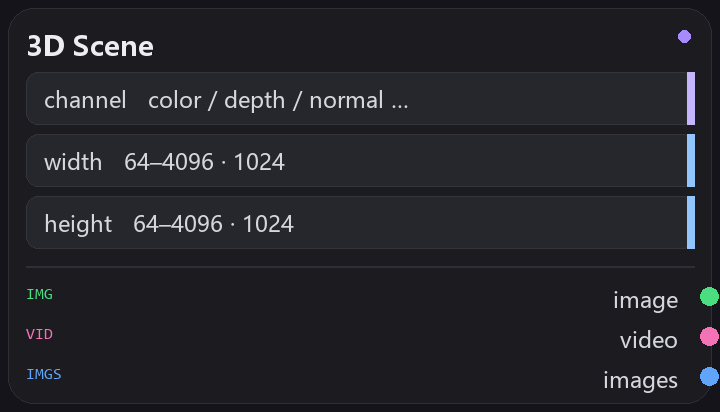

**卡片上的控件：** `channel`（`color`、`depth`、`normal`、`openpose`、`id`；默认 `color`）、`width`（默认 `1024`；范围 `64`–`4096`）、`height`（默认 `1024`；范围 `64`–`4096`）

**送出去：** `image`（`COMFYTV_IMAGE`）、`video`（`COMFYTV_VIDEO`）、`images`（`COMFYTV_IMAGES`）

节点 ID：`ComfyTV.Scene3DStage`

### Storyboard Editor

分镜工作台：排列镜头、写说明、调整时长。

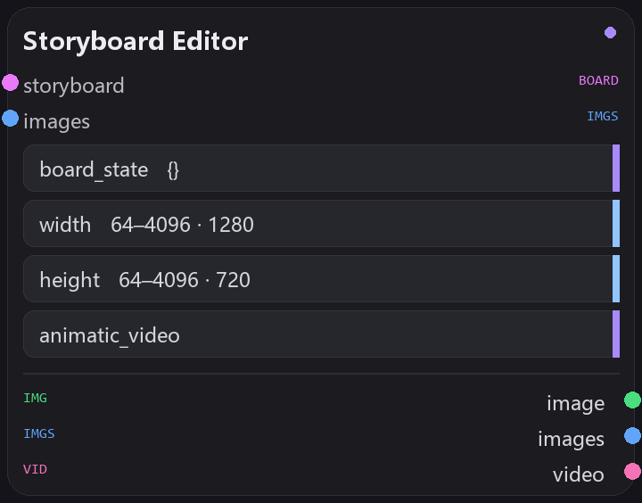

**接进来：** `storyboard`（`COMFYTV_STORYBOARD`）、`images`（`COMFYTV_IMAGES`）

**卡片上的控件：** `board_state`（默认 `{}`）、`width`（默认 `1280`；范围 `64`–`4096`）、`height`（默认 `720`；范围 `64`–`4096`）、`animatic_video`

**送出去：** `image`（`COMFYTV_IMAGE`）、`images`（`COMFYTV_IMAGES`）、`video`（`COMFYTV_VIDEO`）

节点 ID：`ComfyTV.StoryboardEditorStage`

## 生成

从提示词出发，生成文字、图片、视频、语音、音乐、分镜或 3D 模型。这类节点都有运行按钮。

### Custom Stage

挂上你自己的 ComfyUI 工作流，输入输出跟着工作流走。

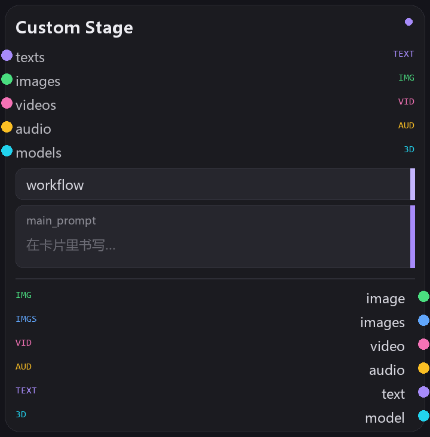

**接进来：** `texts`（最多 8 路 `COMFYTV_TEXT`）、`images`（最多 12 路 `COMFYTV_IMAGE`）、`videos`（最多 6 路 `COMFYTV_VIDEO`）、`audio`（最多 3 路 `COMFYTV_AUDIO`）、`models`（最多 4 路 `COMFYTV_MODEL`）

**卡片上的控件：** `workflow`、`main_prompt`

**送出去：** `image`（`COMFYTV_IMAGE`）、`images`（`COMFYTV_IMAGES`）、`video`（`COMFYTV_VIDEO`）、`audio`（`COMFYTV_AUDIO`）、`text`（`COMFYTV_TEXT`）、`model`（`COMFYTV_MODEL`）

节点 ID：`ComfyTV.CustomStage`

### Director

镜头级的成片控制台：逐条生成片段、加转场，再拼成一条成片。

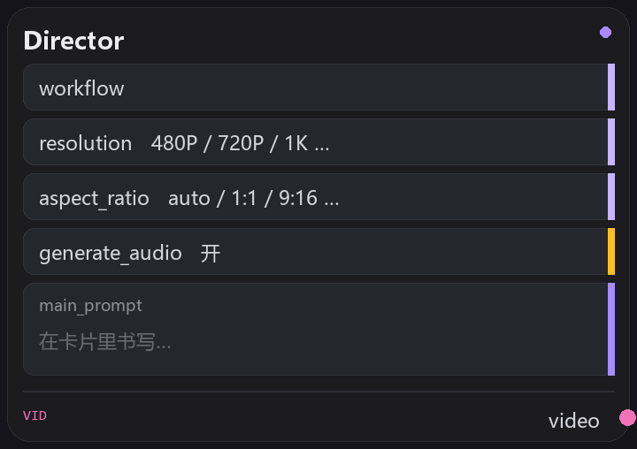

**卡片上的控件：** `workflow`、`resolution`（`480P`、`720P`、`1K`、`1080P`、`1440P`、`2K`、`2160P`、`4K`；默认 `720P`）、`aspect_ratio`（`auto`、`1:1`、`9:16`、`16:9`、`3:4`、`4:3`、`3:2`、`2:3` 等 15 项；默认 `16:9`）、`generate_audio`（默认 `True`）、`main_prompt`

**送出去：** `video`（`COMFYTV_VIDEO`）

节点 ID：`ComfyTV.DirectorStage`

### Text Stage

把提示词交给文字模型，生成一段可复用的文案、脚本或扩写。

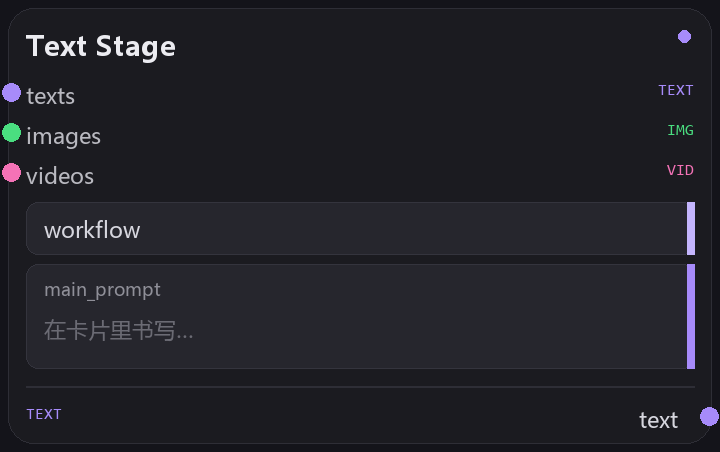

**接进来：** `texts`（最多 8 路 `COMFYTV_TEXT`）、`images`（最多 8 路 `COMFYTV_IMAGE`）、`videos`（最多 4 路 `COMFYTV_VIDEO`）

**卡片上的控件：** `workflow`、`main_prompt`

**送出去：** `text`（`COMFYTV_TEXT`）

节点 ID：`ComfyTV.TextStage`

### Image Stage

文生图或图生图：写画面描述、选模型和比例，一次可出多张。

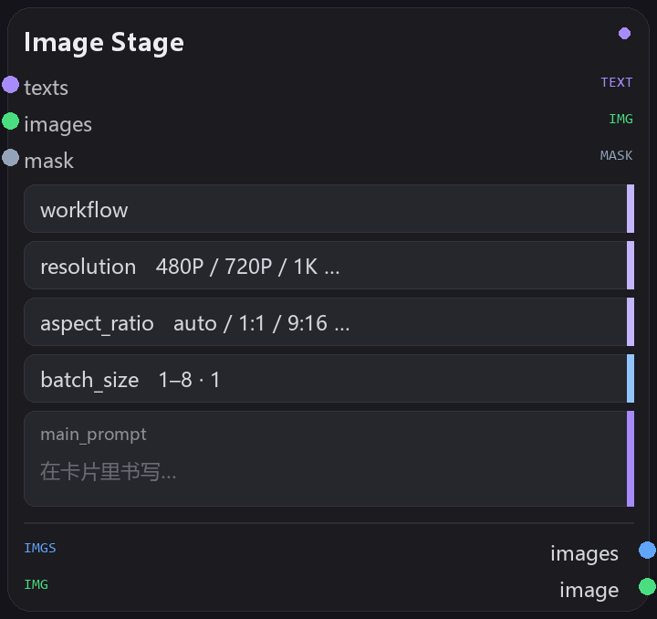

**接进来：** `texts`（最多 8 路 `COMFYTV_TEXT`）、`images`（最多 12 路 `COMFYTV_IMAGE`）、`mask`（`MASK`）

**卡片上的控件：** `workflow`、`resolution`（`480P`、`720P`、`1K`、`1080P`、`1440P`、`2K`、`2160P`、`4K`；默认 `1K`）、`aspect_ratio`（`auto`、`1:1`、`9:16`、`16:9`、`3:4`、`4:3`、`3:2`、`2:3` 等 15 项；默认 `1:1`）、`batch_size`（默认 `1`；范围 `1`–`8`）、`main_prompt`

**送出去：** `images`（`COMFYTV_IMAGES`）、`image`（`COMFYTV_IMAGE`）

节点 ID：`ComfyTV.ImageStage`

### Batch Image Generate

同一套提示词按清单批量出图，适合一整组角色或产品角度。

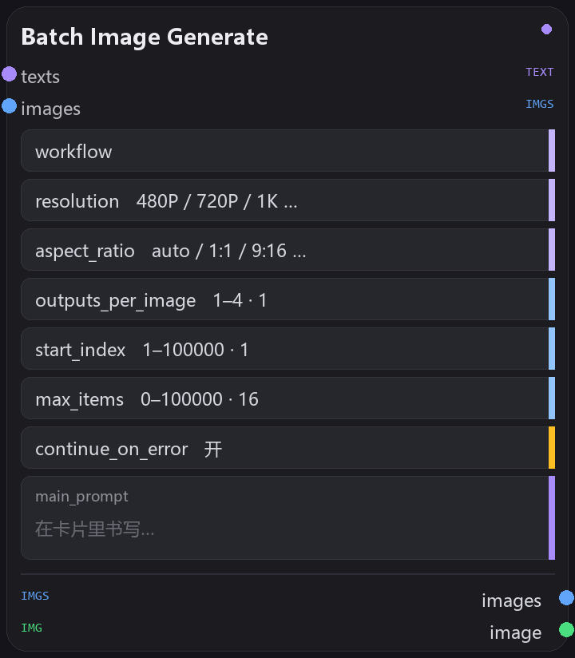

**接进来：** `texts`（最多 8 路 `COMFYTV_TEXT`）、`images`（`COMFYTV_IMAGES`）

**卡片上的控件：** `workflow`、`resolution`（`480P`、`720P`、`1K`、`1080P`、`1440P`、`2K`、`2160P`、`4K`；默认 `1K`）、`aspect_ratio`（`auto`、`1:1`、`9:16`、`16:9`、`3:4`、`4:3`、`3:2`、`2:3` 等 15 项；默认 `1:1`）、`outputs_per_image`（默认 `1`；范围 `1`–`4`）、`start_index`（默认 `1`；范围 `1`–`100000`）、`max_items`（默认 `16`；范围 `0`–`100000`）、`continue_on_error`（默认 `True`）、`main_prompt`

**送出去：** `images`（`COMFYTV_IMAGES`）、`image`（`COMFYTV_IMAGE`）

节点 ID：`ComfyTV.BatchImageStage`

### 3D Model Stage

由文字或参考图生成可旋转的 3D 模型，并顺手截一张预览图。

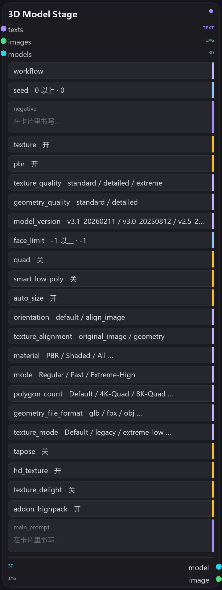

**接进来：** `texts`（最多 4 路 `COMFYTV_TEXT`）、`images`（最多 5 路 `COMFYTV_IMAGE`）、`models`（最多 4 路 `COMFYTV_MODEL`）

**卡片上的控件：** `workflow`、`seed`（默认 `0`；`0` 以上）、`negative`（可选）、`texture`（默认 `True`）、`pbr`（默认 `True`）、`texture_quality`（`standard`、`detailed`、`extreme`；默认 `extreme`）、`geometry_quality`（`standard`、`detailed`；默认 `detailed`）、`model_version`（`v3.1-20260211`、`v3.0-20250812`、`v2.5-20250123`、`meshy-7.1`、`meshy-7`、`meshy-6`、`latest`）、`face_limit`（默认 `-1`；`-1` 以上）、`quad`（默认 `False`）、`smart_low_poly`（默认 `False`）、`auto_size`（默认 `True`）、`orientation`（`default`、`align_image`；默认 `default`）、`texture_alignment`（`original_image`、`geometry`；默认 `original_image`）、`material`（`PBR`、`Shaded`、`All`、`None`；默认 `PBR`）、`mode`（`Regular`、`Fast`、`Extreme-High`；默认 `Extreme-High`）、`polygon_count`（`Default`、`4K-Quad`、`8K-Quad`、`18K-Quad`、`50K-Quad`、`200K-Quad`、`2K-Triangle`、`20K-Triangle` 等 12 项；默认 `1M-Triangle`）、`geometry_file_format`（`glb`、`fbx`、`obj`、`stl`；默认 `glb`）、`texture_mode`（`Default`、`legacy`、`extreme-low`、`low`、`medium`、`high`；默认 `high`）、`tapose`（默认 `False`）、`hd_texture`（默认 `True`）、`texture_delight`（默认 `False`）、`addon_highpack`（默认 `True`）、`main_prompt`

**送出去：** `model`（`COMFYTV_MODEL`）、`image`（`COMFYTV_IMAGE`）

节点 ID：`ComfyTV.Model3DStage`

### Video Stage

文生视频或图生视频：设定分辨率、比例、时长，可选同时生成声音。

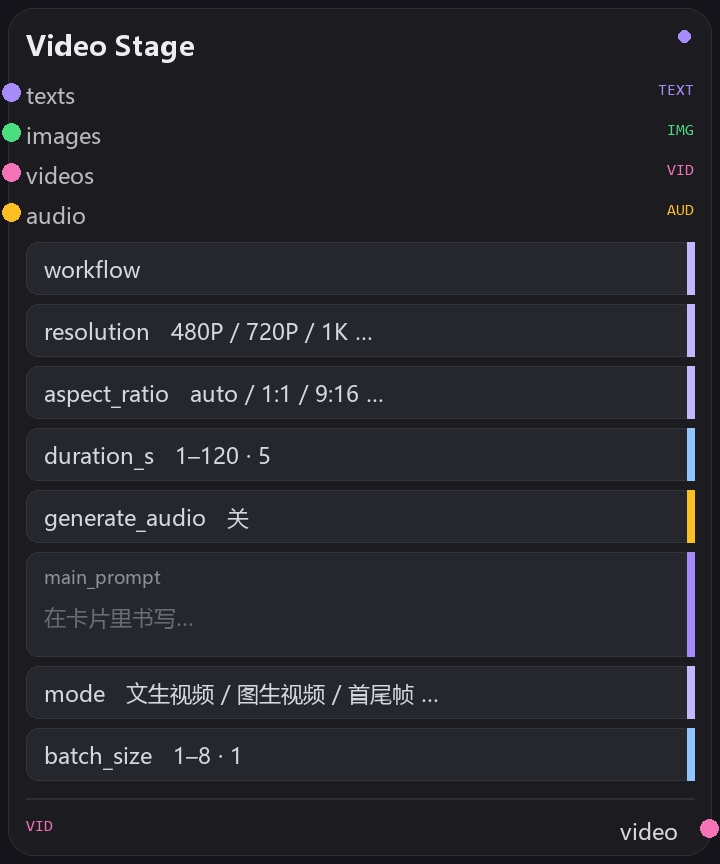

**接进来：** `texts`（最多 6 路 `COMFYTV_TEXT`）、`images`（最多 9 路 `COMFYTV_IMAGE`）、`videos`（最多 4 路 `COMFYTV_VIDEO`）、`audio`（最多 3 路 `COMFYTV_AUDIO`）

**卡片上的控件：** `workflow`、`resolution`（`480P`、`720P`、`1K`、`1080P`、`1440P`、`2K`、`2160P`、`4K`；默认 `720P`）、`aspect_ratio`（`auto`、`1:1`、`9:16`、`16:9`、`3:4`、`4:3`、`3:2`、`2:3` 等 15 项；默认 `16:9`）、`duration_s`（默认 `5`；范围 `1`–`120`）、`generate_audio`（默认 `False`）、`main_prompt`、`mode`（`文生视频`、`图生视频`、`首尾帧`、`全能参考`；默认 `文生视频`）、`batch_size`（默认 `1`；范围 `1`–`8`）

**送出去：** `video`（`COMFYTV_VIDEO`）

节点 ID：`ComfyTV.VideoStage`

### Music Stage

按歌词、调性、BPM 和时长生成一段音乐。

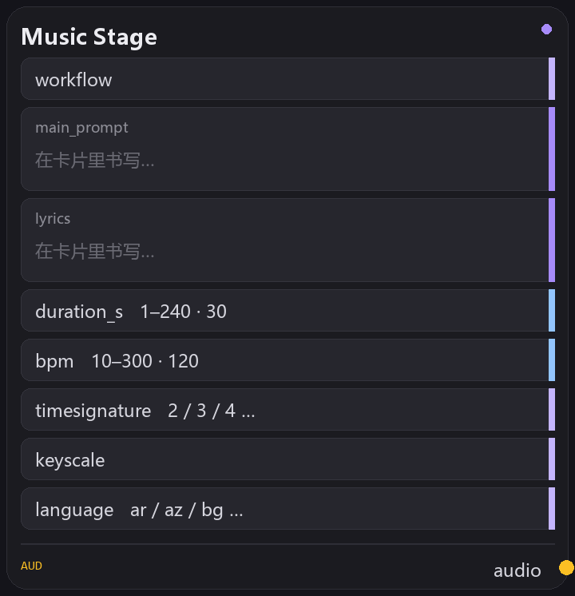

**卡片上的控件：** `workflow`、`main_prompt`、`lyrics`、`duration_s`（默认 `30`；范围 `1`–`240`）、`bpm`（默认 `120`；范围 `10`–`300`）、`timesignature`（`2`、`3`、`4`、`6`；默认 `4`）、`keyscale`（默认 `C major`）、`language`（`ar`、`az`、`bg`、`bn`、`ca`、`cs`、`da`、`de` 等 51 项；默认 `en`）

**送出去：** `audio`（`COMFYTV_AUDIO`）

节点 ID：`ComfyTV.AudioStage`

### Speech Stage

把文字读成语音，可选音色、语种和语速。

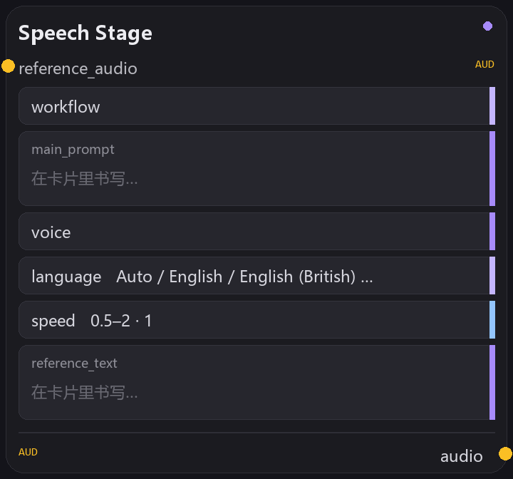

**接进来：** `reference_audio`（`COMFYTV_AUDIO`）

**卡片上的控件：** `workflow`、`main_prompt`、`voice`、`language`（`Auto`、`English`、`English (British)`、`Mandarin Chinese`、`Japanese`、`Korean`、`French`、`German` 等 15 项；默认 `Auto`）、`speed`（默认 `1`；范围 `0.5`–`2`）、`reference_text`

**送出去：** `audio`（`COMFYTV_AUDIO`）

节点 ID：`ComfyTV.SpeechStage`

### Storyboard

把故事拆成分镜：设定总时长和镜头数，产出可编辑的分镜表。

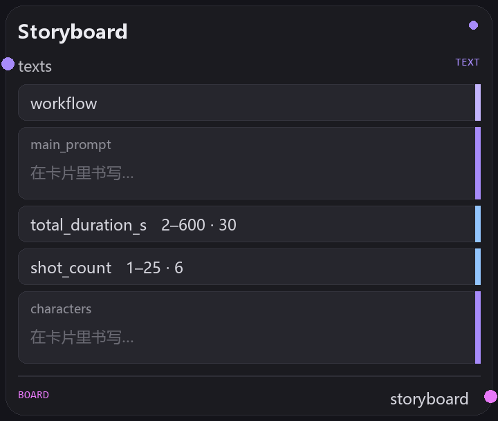

**接进来：** `texts`（最多 6 路 `COMFYTV_TEXT`）

**卡片上的控件：** `workflow`、`main_prompt`、`total_duration_s`（默认 `30`；范围 `2`–`600`）、`shot_count`（默认 `6`；范围 `1`–`25`）、`characters`

**送出去：** `storyboard`（`COMFYTV_STORYBOARD`）

节点 ID：`ComfyTV.StoryboardStage`

## 编排与挑选

从一批结果里挑一个，或把多个镜头编排成一条片子。

### Shot Images

按分镜清单为每个镜头生成对应的画面。

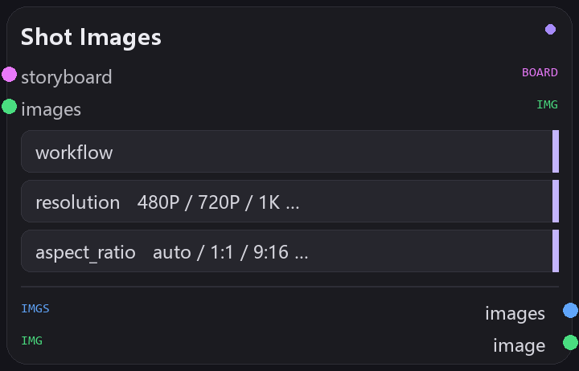

**接进来：** `storyboard`（`COMFYTV_STORYBOARD`）、`images`（最多 8 路 `COMFYTV_IMAGE`）

**卡片上的控件：** `workflow`、`resolution`（`480P`、`720P`、`1K`、`1080P`、`1440P`、`2K`、`2160P`、`4K`；默认 `1K`）、`aspect_ratio`（`auto`、`1:1`、`9:16`、`16:9`、`3:4`、`4:3`、`3:2`、`2:3` 等 15 项；默认 `1:1`）

**送出去：** `images`（`COMFYTV_IMAGES`）、`image`（`COMFYTV_IMAGE`）

节点 ID：`ComfyTV.ShotImagesStage`

### Director Timeline

整理导演时间线的片段顺序、时长和转场数据。

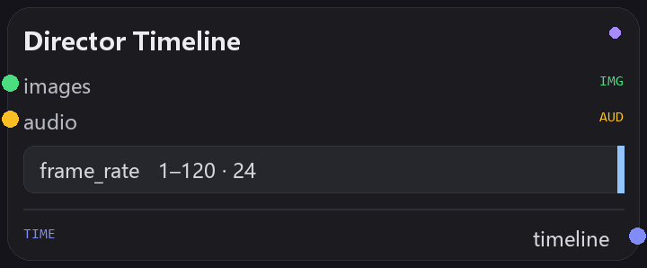

**接进来：** `images`（最多 24 路 `COMFYTV_IMAGE`）、`audio`（`COMFYTV_AUDIO`）

**卡片上的控件：** `frame_rate`（默认 `24`；范围 `1`–`120`）

**送出去：** `timeline`（`COMFYTV_TIMELINE`）

节点 ID：`ComfyTV.DirectorTimelineStage`

### Timeline Render

把时间线渲染成一条可播放的视频。

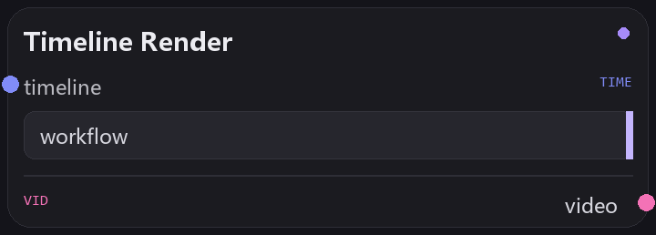

**接进来：** `timeline`（`COMFYTV_TIMELINE`）

**卡片上的控件：** `workflow`

**送出去：** `video`（`COMFYTV_VIDEO`）

节点 ID：`ComfyTV.TimelineVideoStage`

### Compare

左右或滑动对比两张图，方便看改动前后。

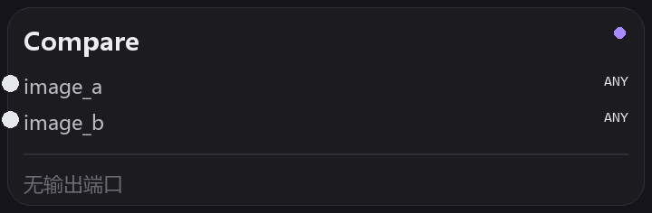

**接进来：** `image_a`（`MULTI`）、`image_b`（`MULTI`）

**送出去：** 无。

节点 ID：`ComfyTV.CompareStage`

### Video Composite

把一层画面按位置和混合模式叠到另一层上。

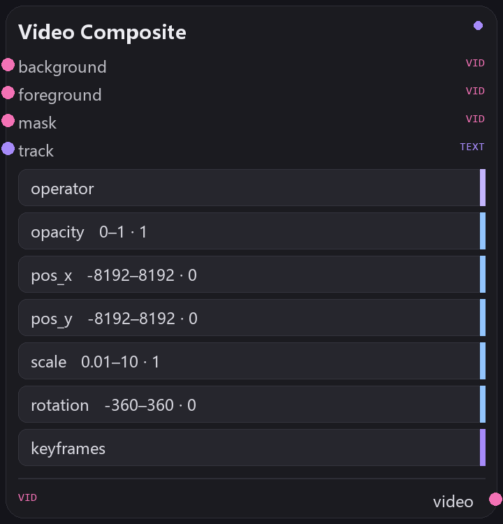

**接进来：** `background`（`COMFYTV_VIDEO`）、`foreground`（`COMFYTV_VIDEO`）、`mask`（`COMFYTV_VIDEO`）、`track`（`COMFYTV_TEXT`）

**卡片上的控件：** `operator`（默认 `over`）、`opacity`（默认 `1`；范围 `0`–`1`）、`pos_x`（默认 `0`；范围 `-8192`–`8192`）、`pos_y`（默认 `0`；范围 `-8192`–`8192`）、`scale`（默认 `1`；范围 `0.01`–`10`）、`rotation`（默认 `0`；范围 `-360`–`360`）、`keyframes`

**送出去：** `video`（`COMFYTV_VIDEO`）

节点 ID：`ComfyTV.VideoCompositeStage`

### Video Concat

把多段视频首尾相接成一条。

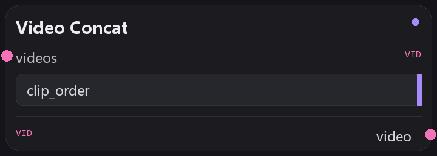

**接进来：** `videos`（最多 12 路 `COMFYTV_VIDEO`）

**卡片上的控件：** `clip_order`

**送出去：** `video`（`COMFYTV_VIDEO`）

节点 ID：`ComfyTV.VideoConcatStage`

### Video Transition

在两段视频之间做淡化、擦除等转场。

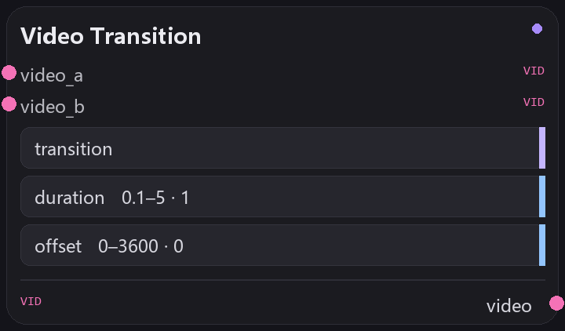

**接进来：** `video_a`（`COMFYTV_VIDEO`）、`video_b`（`COMFYTV_VIDEO`）

**卡片上的控件：** `transition`（默认 `fade`）、`duration`（默认 `1`；范围 `0.1`–`5`）、`offset`（默认 `0`；范围 `0`–`3600`）

**送出去：** `video`（`COMFYTV_VIDEO`）

节点 ID：`ComfyTV.VideoTransitionStage`

### Luma Wipe

按亮度用一张图做转场擦除。

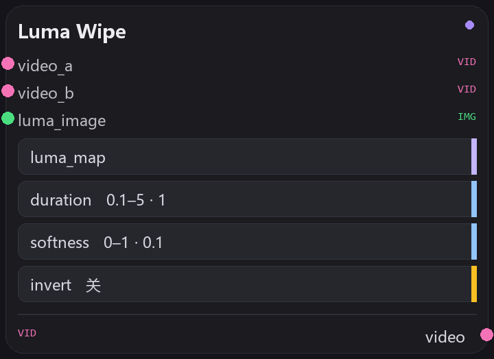

**接进来：** `video_a`（`COMFYTV_VIDEO`）、`video_b`（`COMFYTV_VIDEO`）、`luma_image`（`COMFYTV_IMAGE`）

**卡片上的控件：** `luma_map`（默认 `radial`）、`duration`（默认 `1`；范围 `0.1`–`5`）、`softness`（默认 `0.1`；范围 `0`–`1`）、`invert`（默认 `False`）

**送出去：** `video`（`COMFYTV_VIDEO`）

节点 ID：`ComfyTV.VideoLumaWipeStage`

### Sequence

按顺序拼接多段视频，做成一条连续成片。

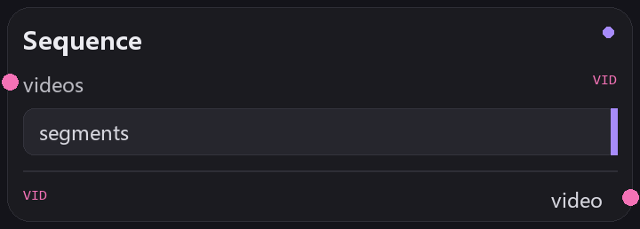

**接进来：** `videos`（最多 12 路 `COMFYTV_VIDEO`）

**卡片上的控件：** `segments`

**送出去：** `video`（`COMFYTV_VIDEO`）

节点 ID：`ComfyTV.SequenceStage`

## 图像编辑

裁剪、旋转、重绘、抠图、放大、调色。多数在卡片里即时预览，需要出文件时才运行。

### Canvas

一块空白画布，用来从零拼贴图层。

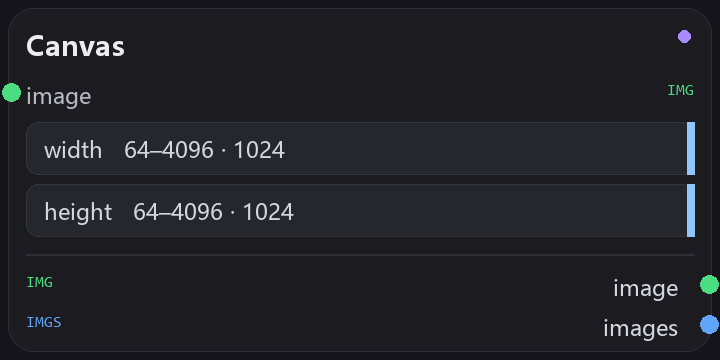

**接进来：** `image`（`COMFYTV_IMAGE`）

**卡片上的控件：** `width`（默认 `1024`；范围 `64`–`4096`）、`height`（默认 `1024`；范围 `64`–`4096`）

**送出去：** `image`（`COMFYTV_IMAGE`）、`images`（`COMFYTV_IMAGES`）

节点 ID：`ComfyTV.CanvasStage`

### Layer Separation

把一张图拆成可分别编辑的前景、主体和背景层。

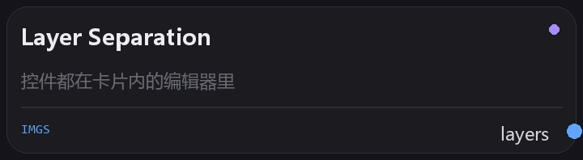

**送出去：** `layers`（`COMFYTV_IMAGES`）

节点 ID：`ComfyTV.LayerSeparationStage`

### Upscale

按倍数放大图片，并尽量补回细节。

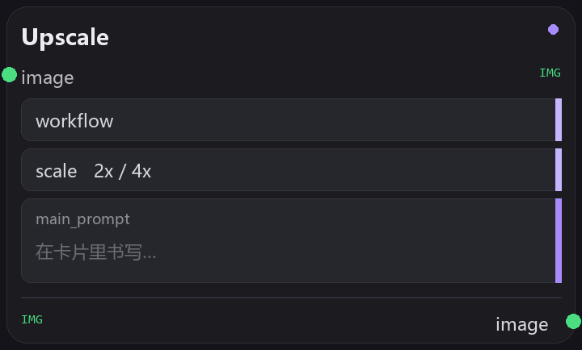

**接进来：** `image`（`COMFYTV_IMAGE`）

**卡片上的控件：** `workflow`、`scale`（`2x`、`4x`；默认 `2x`）、`main_prompt`

**送出去：** `image`（`COMFYTV_IMAGE`）

节点 ID：`ComfyTV.UpscaleStage`

### Outpaint

把画面向四周延伸，补出原本没有的内容。

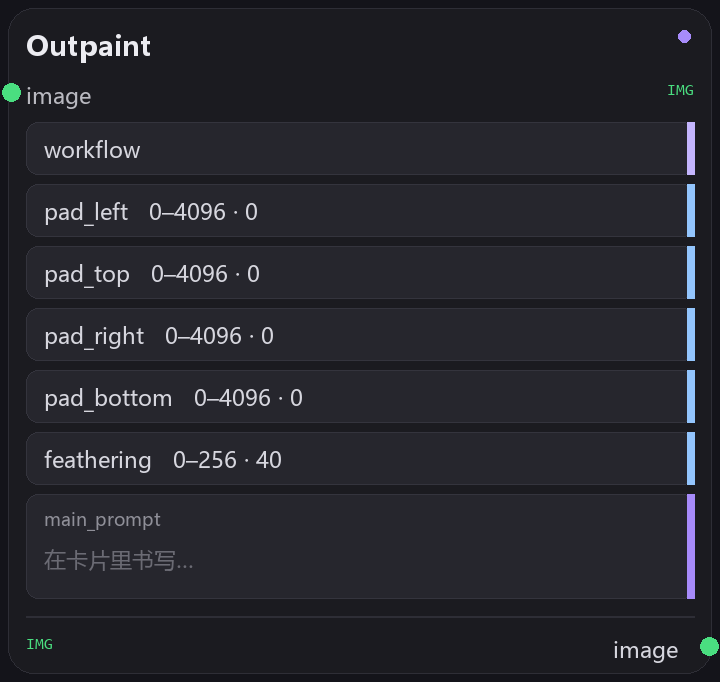

**接进来：** `image`（`COMFYTV_IMAGE`）

**卡片上的控件：** `workflow`、`pad_left`（默认 `0`；范围 `0`–`4096`）、`pad_top`（默认 `0`；范围 `0`–`4096`）、`pad_right`（默认 `0`；范围 `0`–`4096`）、`pad_bottom`（默认 `0`；范围 `0`–`4096`）、`feathering`（默认 `40`；范围 `0`–`256`）、`main_prompt`

**送出去：** `image`（`COMFYTV_IMAGE`）

节点 ID：`ComfyTV.OutpaintStage`

### Inpaint

只重绘蒙版盖住的区域，其余画面保持不动。

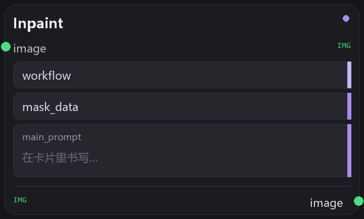

**接进来：** `image`（`COMFYTV_IMAGE`）

**卡片上的控件：** `workflow`、`mask_data`、`main_prompt`

**送出去：** `image`（`COMFYTV_IMAGE`）

节点 ID：`ComfyTV.InpaintStage`

### Image Edit

按文字指令整体修改一张图，例如换衣服、改背景、改风格。

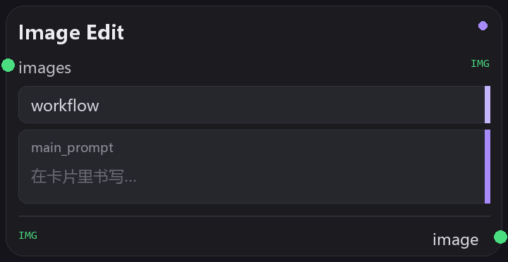

**接进来：** `images`（最多 12 路 `COMFYTV_IMAGE`）

**卡片上的控件：** `workflow`、`main_prompt`

**送出去：** `image`（`COMFYTV_IMAGE`）

节点 ID：`ComfyTV.ImageEditStage`

### Erase

抹掉画面里圈出的物体，并用周围内容补上。

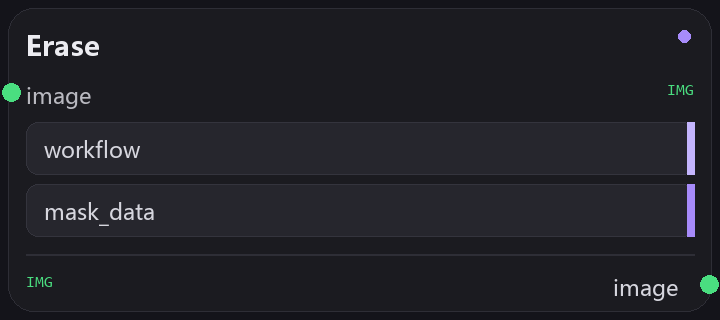

**接进来：** `image`（`COMFYTV_IMAGE`）

**卡片上的控件：** `workflow`、`mask_data`

**送出去：** `image`（`COMFYTV_IMAGE`）

节点 ID：`ComfyTV.EraseStage`

### Cutout

把主体从背景里扣出来，得到透明底图片。

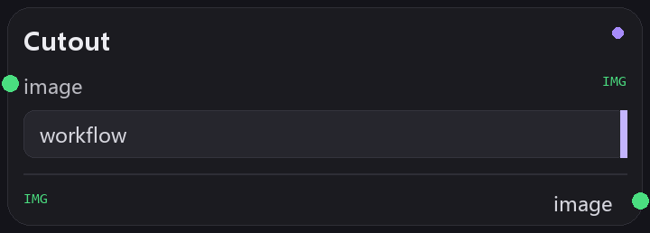

**接进来：** `image`（`COMFYTV_IMAGE`）

**卡片上的控件：** `workflow`

**送出去：** `image`（`COMFYTV_IMAGE`）

节点 ID：`ComfyTV.CutoutStage`

### Multiangle

从新的机位角度重绘同一主体。

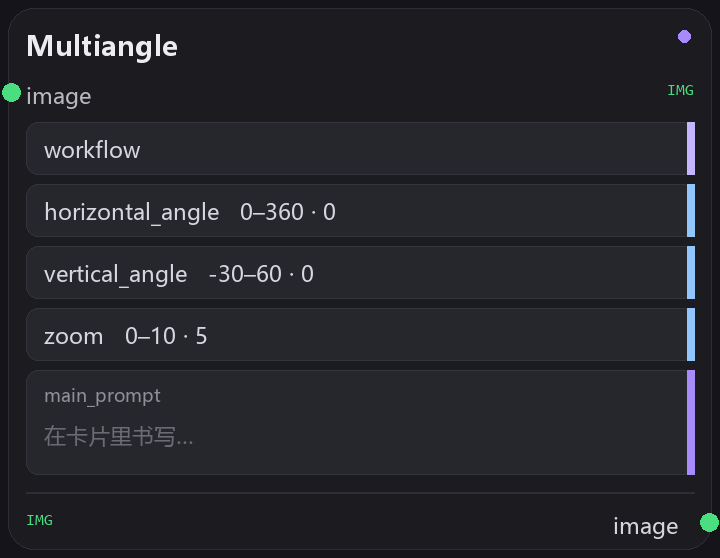

**接进来：** `image`（`COMFYTV_IMAGE`）

**卡片上的控件：** `workflow`、`horizontal_angle`（默认 `0`；范围 `0`–`360`）、`vertical_angle`（默认 `0`；范围 `-30`–`60`）、`zoom`（默认 `5`；范围 `0`–`10`）、`main_prompt`

**送出去：** `image`（`COMFYTV_IMAGE`）

节点 ID：`ComfyTV.MultiangleStage`

### Poster

海报排版：把文字、图片、图表摆进一张版式。

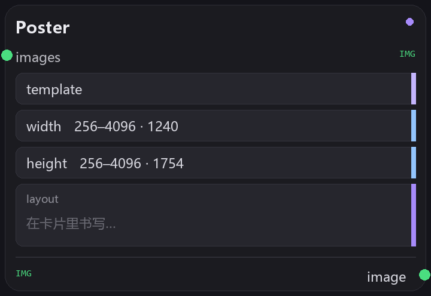

**接进来：** `images`（最多 12 路 `COMFYTV_IMAGE`）

**卡片上的控件：** `template`、`width`（默认 `1240`；范围 `256`–`4096`）、`height`（默认 `1754`；范围 `256`–`4096`）、`layout`（默认 `{}`）

**送出去：** `image`（`COMFYTV_IMAGE`）

节点 ID：`ComfyTV.PosterStage`

### Split Parts

按部件把主体拆成多张，便于逐件修改。

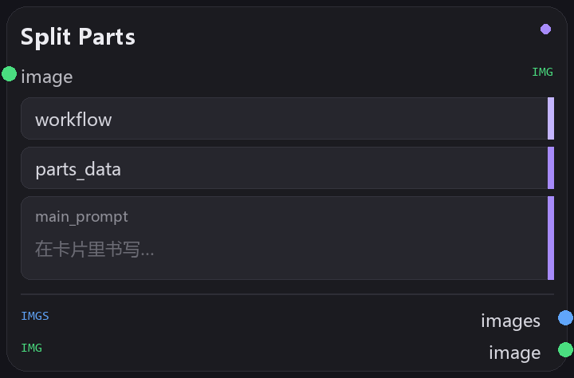

**接进来：** `image`（`COMFYTV_IMAGE`）

**卡片上的控件：** `workflow`、`parts_data`、`main_prompt`

**送出去：** `images`（`COMFYTV_IMAGES`）、`image`（`COMFYTV_IMAGE`）

节点 ID：`ComfyTV.SplitPartStage`

### Crop

在图上拖一个选区，只保留选中的部分。

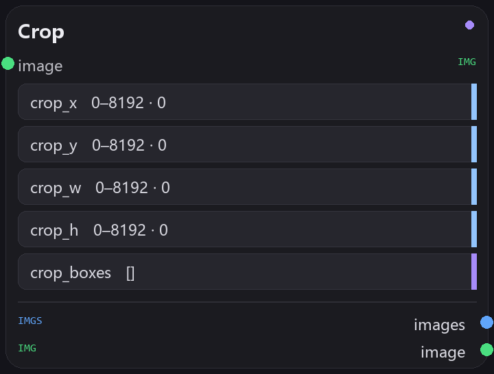

**接进来：** `image`（`COMFYTV_IMAGE`）

**卡片上的控件：** `crop_x`（默认 `0`；范围 `0`–`8192`）、`crop_y`（默认 `0`；范围 `0`–`8192`）、`crop_w`（默认 `0`；范围 `0`–`8192`）、`crop_h`（默认 `0`；范围 `0`–`8192`）、`crop_boxes`（默认 `[]`）

**送出去：** `images`（`COMFYTV_IMAGES`）、`image`（`COMFYTV_IMAGE`）

节点 ID：`ComfyTV.CropStage`

### Rotate

按角度旋转图片，也可用 90° 快捷按钮。

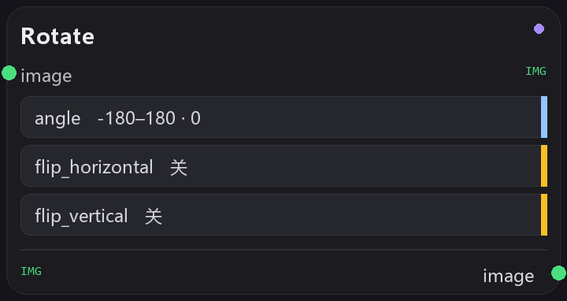

**接进来：** `image`（`COMFYTV_IMAGE`）

**卡片上的控件：** `angle`（默认 `0`；范围 `-180`–`180`）、`flip_horizontal`（默认 `False`）、`flip_vertical`（默认 `False`）

**送出去：** `image`（`COMFYTV_IMAGE`）

节点 ID：`ComfyTV.RotateStage`

### Color Grade

用曝光、对比、饱和等滑杆给图片调色。

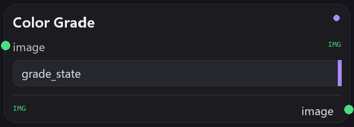

**接进来：** `image`（`COMFYTV_IMAGE`）

**卡片上的控件：** `grade_state`

**送出去：** `image`（`COMFYTV_IMAGE`）

节点 ID：`ComfyTV.ColorGradeStage`

### Mirror

水平或垂直翻转图片。

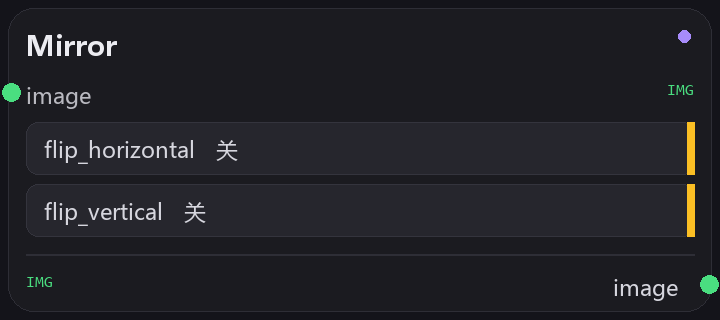

**接进来：** `image`（`COMFYTV_IMAGE`）

**卡片上的控件：** `flip_horizontal`（默认 `False`）、`flip_vertical`（默认 `False`）

**送出去：** `image`（`COMFYTV_IMAGE`）

节点 ID：`ComfyTV.MirrorStage`

### Grid Split

按行列把一张图切成规则网格。

**接进来：** `image`（`COMFYTV_IMAGE`）

**卡片上的控件：** `rows`（默认 `2`；范围 `1`–`10`）、`cols`（默认 `2`；范围 `1`–`10`）、`border`（默认 `0`；范围 `0`–`4096`）、`outer_border`（默认 `False`）

**送出去：** `images`（`COMFYTV_IMAGES`）、`image`（`COMFYTV_IMAGE`）

节点 ID：`ComfyTV.GridSplitStage`

### Custom Split

按自定义区域把一张图拆成多张。

**接进来：** `image`（`COMFYTV_IMAGE`）

**卡片上的控件：** `v_splits`（默认 `[0.5]`）、`h_splits`（默认 `[]`）、`cell_labels`（默认 `[]`）

**送出去：** `images`（`COMFYTV_IMAGES`）、`image`（`COMFYTV_IMAGE`）

节点 ID：`ComfyTV.CustomSplitStage`

### Split Images

把一批图片拆开，逐张往下送。

**接进来：** `images`（`MULTI`）

**卡片上的控件：** `slot_overrides`（默认 `{}`）

**送出去：** 无。

节点 ID：`ComfyTV.ImagesSplitStage`

### Merge Images

把多张图片合成一张。

**接进来：** `images`（最多 ? 路 ``）

**卡片上的控件：** `merge_mode`（`layers`、`row`；默认 `layers`）、`aspect_ratio`（`native`、`1:1`；默认 `native`）

**送出去：** `image`（`COMFYTV_IMAGE`）

节点 ID：`ComfyTV.ImageMergeStage`

### Image Variations

用一张图生成一组多角度或连续场景的变体。

**接进来：** `image`（`COMFYTV_IMAGE`）

**卡片上的控件：** `workflow`、`variant_count`（默认 `3`；范围 `1`–`25`）、`main_prompt`

**送出去：** `images`（`COMFYTV_IMAGES`）、`image`（`COMFYTV_IMAGE`）

节点 ID：`ComfyTV.ImageVariationsStage`

## 全景

生成全景，再从里面截出你要对准的视角。

### Panorama

生成或承载一张可环视的全景图。

**接进来：** `image`（`COMFYTV_IMAGE`）

**卡片上的控件：** `workflow`、`main_prompt`、`manual_source`

**送出去：** `panorama`（`COMFYTV_PANORAMA`）

节点 ID：`ComfyTV.PanoramaStage`

### Panorama · Current View

从全景里截取你当前朝向的一张平面图。

**接进来：** `panorama`（`COMFYTV_PANORAMA`）

**卡片上的控件：** `yaw`（默认 `0`；范围 `-180`–`180`）、`pitch`（默认 `0`；范围 `-89`–`89`）、`fov`（默认 `75`；范围 `10`–`120`）、`aspect_ratio`（`auto`、`1:1`、`9:16`、`16:9`、`3:4`、`4:3`、`3:2`、`2:3` 等 15 项；默认 `16:9`）、`resolution`（`480P`、`720P`、`1K`、`1080P`、`1440P`、`2K`、`2160P`、`4K`；默认 `1K`）

**送出去：** `image`（`COMFYTV_IMAGE`）

节点 ID：`ComfyTV.PanoramaCurrentViewStage`

### Panorama · Multi-View

从全景里一次截出前后左右等多个视角。

**接进来：** `panorama`（`COMFYTV_PANORAMA`）

**卡片上的控件：** `view_count`（默认 `4`；范围 `1`–`64`）、`aspect_ratio`（`auto`、`1:1`、`9:16`、`16:9`、`3:4`、`4:3`、`3:2`、`2:3` 等 15 项；默认 `16:9`）、`resolution`（`480P`、`720P`、`1K`、`1080P`、`1440P`、`2K`、`2160P`、`4K`；默认 `1K`）

**送出去：** `images`（`COMFYTV_IMAGES`）、`image`（`COMFYTV_IMAGE`）

节点 ID：`ComfyTV.PanoramaMultiViewStage`

## 视频剪辑

剪一段、拼一段、改分辨率、抽帧、分离音视频。

### Scene Detect

找出镜头切换的位置，并可按场景拆开。

**接进来：** `video`（`COMFYTV_VIDEO`）

**卡片上的控件：** `threshold`（默认 `0.4`；范围 `0.05`–`1`）、`min_gap_s`（默认 `1`；范围 `0`–`30`）、`output`（`frames`、`clips`；默认 `frames`）、`cut_mode`（`fast`、`precise`；默认 `fast`）

**送出去：** `images`（`COMFYTV_IMAGES`）、`clips`（`COMFYTV_VIDEO`）

节点 ID：`ComfyTV.SceneDetectStage`

### Video Scopes

显示波形、矢量、直方图等示波器画面。

**接进来：** `video`（`COMFYTV_VIDEO`）

**卡片上的控件：** `scope`（默认 `waveform`）、`at_seconds`（默认 `-1`；范围 `-1`–`3600`）

**送出去：** `image`（`COMFYTV_IMAGE`）

节点 ID：`ComfyTV.VideoScopesStage`

### Contact Sheet

把多帧排成一张联络表，方便总览。

**接进来：** `video`（`COMFYTV_VIDEO`）

**卡片上的控件：** `cols`（默认 `4`；范围 `1`–`12`）、`rows`（默认 `4`；范围 `1`–`12`）、`sheet_width`（默认 `1920`；范围 `320`–`8192`）、`timecode`（默认 `True`）

**送出去：** `image`（`COMFYTV_IMAGE`）

节点 ID：`ComfyTV.ContactSheetStage`

### Extract Frame

从视频里抽出指定时刻的一帧静图。

**接进来：** `video`（`COMFYTV_VIDEO`）

**卡片上的控件：** `position`（`last`、`first`、`middle`、`custom`；默认 `last`）、`at_seconds`（默认 `0`；范围 `0`–`3600`）

**送出去：** `image`（`COMFYTV_IMAGE`）

节点 ID：`ComfyTV.VideoExtractFrameStage`

### Video Clip

拖动入点和出点，只保留视频中间的一段。

**接进来：** `video`（`COMFYTV_VIDEO`）

**卡片上的控件：** `start_s`（默认 `0`；范围 `0`–`3600`）、`end_s`（默认 `0`；范围 `0`–`3600`）

**送出去：** `video`（`COMFYTV_VIDEO`）

节点 ID：`ComfyTV.VideoClipStage`

### Video Crop

裁掉视频画面的边缘，只留中间区域。

**接进来：** `video`（`COMFYTV_VIDEO`）

**卡片上的控件：** `x`（默认 `0`；范围 `0`–`8192`）、`y`（默认 `0`；范围 `0`–`8192`）、`w`（默认 `0`；范围 `0`–`8192`）、`h`（默认 `0`；范围 `0`–`8192`）

**送出去：** `video`（`COMFYTV_VIDEO`）

节点 ID：`ComfyTV.VideoCropStage`

### Video Speed

加快或放慢视频，可选是否保持音调。

**接进来：** `video`（`COMFYTV_VIDEO`）

**卡片上的控件：** `speed`（默认 `1`；范围 `0.1`–`10`）、`reverse`（默认 `False`）、`pitch_compensate`（默认 `True`）

**送出去：** `video`（`COMFYTV_VIDEO`）

节点 ID：`ComfyTV.VideoSpeedStage`

### Video Rotate

旋转或翻转整段视频。

**接进来：** `video`（`COMFYTV_VIDEO`）

**卡片上的控件：** `rotate_deg`（默认 `0`；范围 `0`–`270`）、`flip_h`（默认 `False`）、`flip_v`（默认 `False`）

**送出去：** `video`（`COMFYTV_VIDEO`）

节点 ID：`ComfyTV.VideoRotateStage`

### Video Split

在某个时间点把视频切成前后两段。

**接进来：** `video`（`COMFYTV_VIDEO`）

**卡片上的控件：** `split_s`（默认 `0`；范围 `0`–`3600`）

**送出去：** `video_a`（`COMFYTV_VIDEO`）、`video_b`（`COMFYTV_VIDEO`）

节点 ID：`ComfyTV.VideoSplitStage`

### Video Volume

调整视频里原有声音的音量。

**接进来：** `video`（`COMFYTV_VIDEO`）

**卡片上的控件：** `volume`（默认 `1`；范围 `0`–`8`）、`fade_in_s`（默认 `0`；范围 `0`–`60`）、`fade_out_s`（默认 `0`；范围 `0`–`60`）

**送出去：** `video`（`COMFYTV_VIDEO`）

节点 ID：`ComfyTV.VideoVolumeStage`

### Mux Audio

给视频换上或叠上一条新的音轨。

**接进来：** `video`（`COMFYTV_VIDEO`）、`audio`（`COMFYTV_AUDIO`）

**卡片上的控件：** `mode`（`replace`、`mix`；默认 `replace`）、`offset_s`（默认 `0`；范围 `-600`–`600`）

**送出去：** `video`（`COMFYTV_VIDEO`）

节点 ID：`ComfyTV.VideoMuxAudioStage`

### Extract Frames

按标记的时间点抽出多帧静图。

**接进来：** `video`（`COMFYTV_VIDEO`）

**卡片上的控件：** `marks`

**送出去：** `images`（`COMFYTV_IMAGES`）

节点 ID：`ComfyTV.VideoFramesStage`

### Video to Frames

把整段视频按间隔拆成一串图片。

**接进来：** `video`（`COMFYTV_VIDEO`）

**卡片上的控件：** `mode`（`all`、`every_n`、`target_fps`；默认 `all`）、`every_n`（默认 `1`；范围 `1`–`1000`）、`target_fps`（默认 `12`；范围 `0.1`–`240`）、`start_s`（默认 `0`；范围 `0`–`86400`）、`end_s`（默认 `0`；范围 `0`–`86400`）、`max_frames`（默认 `2000`；范围 `0`–`100000`）、`image_format`（`png`、`jpeg`；默认 `png`）、`jpeg_quality`（默认 `95`；范围 `1`–`100`）

**送出去：** `images`（`COMFYTV_IMAGES`）

节点 ID：`ComfyTV.VideoToFramesStage`

### Video Resize

改变视频的分辨率和画面比例。

**接进来：** `video`（`COMFYTV_VIDEO`）

**卡片上的控件：** `width`（默认 `1280`；范围 `-1`–`8192`）、`height`（默认 `720`；范围 `-1`–`8192`）

**送出去：** `video`（`COMFYTV_VIDEO`）

节点 ID：`ComfyTV.VideoResizeStage`

### Video Upscale

放大视频分辨率并补细节。

**接进来：** `video`（`COMFYTV_VIDEO`）

**卡片上的控件：** `scale`（`2x`、`4x`；默认 `2x`）

**送出去：** `video`（`COMFYTV_VIDEO`）

节点 ID：`ComfyTV.VideoUpscaleStage`

### Subtitle Erase (Smart)

自动找出并抹掉画面里的字幕。

**接进来：** `video`（`COMFYTV_VIDEO`）

**送出去：** `video`（`COMFYTV_VIDEO`）

节点 ID：`ComfyTV.VideoSubtitleSmartEraseStage`

### Subtitle Erase (Region)

只抹掉你框选区域内的字幕。

**接进来：** `video`（`COMFYTV_VIDEO`）

**卡片上的控件：** `region_x`（默认 `0`；范围 `0`–`8192`）、`region_y`（默认 `0`；范围 `0`–`8192`）、`region_w`（默认 `0`；范围 `0`–`8192`）、`region_h`（默认 `0`；范围 `0`–`8192`）

**送出去：** `video`（`COMFYTV_VIDEO`）

节点 ID：`ComfyTV.VideoSubtitleSelectEraseStage`

### Make Proxy

生成一份轻量的预览副本，方便拖动时间线时保持流畅。

**卡片上的控件：** `video`

**送出去：** `proxy`（`COMFYTV_VIDEO`）

节点 ID：`ComfyTV.MakeProxyStage`

### Pattern

生成纯色、渐变、条纹、网格等测试图案视频。

**卡片上的控件：** `kind`（默认 `ramp`）、`width`（默认 `1280`；范围 `16`–`4096`）、`height`（默认 `720`；范围 `16`–`4096`）、`fps`（默认 `24`；范围 `1`–`120`）、`duration`（默认 `5`；范围 `0.5`–`120`）、`color0`（默认 `#000000`）、`color1`（默认 `#FFFFFF`）、`p0_x`（默认 `0`；范围 `0`–`1`）、`p0_y`（默认 `0.5`；范围 `0`–`1`）、`p1_x`（默认 `1`；范围 `0`–`1`）、`p1_y`（默认 `0.5`；范围 `0`–`1`）、`interp`（默认 `linear`）、`softness`（默认 `0`；范围 `0`–`1`）、`noise_scale`（默认 `64`；范围 `4`–`512`）、`noise_octaves`（默认 `4`；范围 `1`–`8`）、`noise_speed`（默认 `1`；范围 `0`–`10`）、`seed`（默认 `7`；范围 `0`–`99999`）、`box_size`（默认 `64`；范围 `2`–`1024`）、`bar_intensity`（默认 `75`；范围 `1`–`100`）、`wheel_gamma`（默认 `0.45`；范围 `0`–`4`）、`wheel_rotate`（默认 `0`；范围 `-180`–`180`）、`count_style`（`seconds`、`frames`；默认 `seconds`）、`count_direction`（`down`、`up`；默认 `down`）

**送出去：** `video`（`COMFYTV_VIDEO`）

节点 ID：`ComfyTV.PatternStage`

### Ken Burns

让静图缓慢推拉摇移，做成视频。

**接进来：** `image`（`COMFYTV_IMAGE`）

**卡片上的控件：** `width`（默认 `1280`；范围 `16`–`4096`）、`height`（默认 `720`；范围 `16`–`4096`）、`fps`（默认 `24`；范围 `1`–`120`）、`duration`（默认 `5`；范围 `0.5`–`120`）、`start_zoom`（默认 `1`；范围 `1`–`6`）、`end_zoom`（默认 `1.3`；范围 `1`–`6`）、`start_x`（默认 `0.5`；范围 `0`–`1`）、`start_y`（默认 `0.5`；范围 `0`–`1`）、`end_x`（默认 `0.5`；范围 `0`–`1`）、`end_y`（默认 `0.5`；范围 `0`–`1`）、`interp`（`linear`、`smooth`、`ease_in`、`ease_out`；默认 `smooth`）

**送出去：** `video`（`COMFYTV_VIDEO`）

节点 ID：`ComfyTV.KenBurnsStage`

### Motion Track

点选画面上的点并跟踪它在整段视频里的运动。

**接进来：** `video`（`COMFYTV_VIDEO`）

**卡片上的控件：** `points`、`point_x`（默认 `0`；范围 `0`–`8192`）、`point_y`（默认 `0`；范围 `0`–`8192`）、`solve`（`none`、`translation`、`similarity`、`perspective`；默认 `none`）、`t_start`（默认 `0`；范围 `0`–`3600`）、`t_end`（默认 `-1`；范围 `-1`–`3600`）、`pattern`（默认 `12`；范围 `4`–`64`）、`search`（默认 `24`；范围 `8`–`128`）

**送出去：** `track`（`COMFYTV_TEXT`）

节点 ID：`ComfyTV.MotionTrackStage`

### Title

在视频上叠标题文字，可调字体、位置和出现时间。

**接进来：** `video`（`COMFYTV_VIDEO`）

**卡片上的控件：** `text`、`font`、`size`（默认 `48`；范围 `8`–`400`）、`color`（默认 `#FFFFFF`）、`stroke`（默认 `0`；范围 `0`–`20`）、`stroke_color`（默认 `#000000`）、`anchor`（`bottom`、`top`、`center`、`top-left`、`top-right`、`bottom-left`、`bottom-right`；默认 `bottom`）、`t_start`（默认 `0`；范围 `0`–`3600`）、`t_end`（默认 `-1`；范围 `-1`–`3600`）、`fade_s`（默认 `0`；范围 `0`–`10`）、`typewriter`（`off`、`char`、`word`、`line`；默认 `off`）、`type_step`（默认 `0.1`；范围 `0.02`–`2`）

**送出去：** `video`（`COMFYTV_VIDEO`）

节点 ID：`ComfyTV.TitleStage`

### Subtitles

把字幕文件烧录到视频画面上。

**接进来：** `video`（`COMFYTV_VIDEO`）、`subs_text`（`COMFYTV_TEXT`）

**卡片上的控件：** `subs`、`font`、`size`（默认 `36`；范围 `8`–`200`）、`color`（默认 `#FFFFFF`）、`stroke`（默认 `2`；范围 `0`–`20`）、`anchor`（`bottom`、`top`；默认 `bottom`）

**送出去：** `video`（`COMFYTV_VIDEO`）

节点 ID：`ComfyTV.SubtitleStage`

### Subtitles · Speech-to-Text

听视频里的说话声，自动生成字幕文本。

**接进来：** `video`（`COMFYTV_VIDEO`）、`audio`（`COMFYTV_AUDIO`）

**卡片上的控件：** `workflow`

**送出去：** `subtitles`（`COMFYTV_TEXT`）

节点 ID：`ComfyTV.SubtitleGenStage`

### Time Remap

用一条速度曲线重新安排视频的时间。

**接进来：** `video`（`COMFYTV_VIDEO`）

**卡片上的控件：** `mode`（`speed`、`hold`；默认 `speed`）、`speed_keys`、`smooth_fps`（默认 `0`；范围 `0`–`120`）、`hold_frame`（默认 `0`；范围 `0`–`100000`）、`hold_increment`（默认 `0`；范围 `0`–`1000`）

**送出去：** `video`（`COMFYTV_VIDEO`）

节点 ID：`ComfyTV.TimeRemapStage`

### VP9 to VP8 Alpha

把 VP9 透明视频转成兼容性更好的 VP8。

**接进来：** `video`（`COMFYTV_VIDEO`）

**卡片上的控件：** `quality`（`draft`、`standard`、`high`；默认 `high`）

**送出去：** `video`（`COMFYTV_VIDEO`）

节点 ID：`ComfyTV.VP9ToVP8`

## 视频特效

调色、风格化、镜头、粒子和时间特效。滑杆在卡片里实时预览，FX Chain 负责一次渲染整串效果。

### Expression

用数学表达式生成随时间变化的关键帧曲线。

**接进来：** `video`（`COMFYTV_VIDEO`）

**卡片上的控件：** `expression`（默认 `sin(t*2)*10`）、`field`（默认 `v`）、`rate`（默认 `10`；范围 `1`–`60`）、`duration`（默认 `5`；范围 `0.05`–`3600`）、`fps`（默认 `24`；范围 `1`–`120`）、`seed`（默认 `0`；范围 `0`–`99999`）

**送出去：** `keyframes`（`COMFYTV_TEXT`）

节点 ID：`ComfyTV.ExpressionStage`

### FX Chain

把一串特效合成一次渲染，输出最终视频。

**接进来：** `video`（`COMFYTV_VIDEO`）

**卡片上的控件：** `out_colorspace`（默认 `bt709`）、`out_size`（默认 `source`）、`out_fps`（默认 `source`）、`out_codec`（默认 `h264`）、`out_quality`（默认 `standard`）

**送出去：** `video`（`COMFYTV_VIDEO`）

节点 ID：`ComfyTV.FXChainStage`

### Art FX

一组偏艺术化的画面处理，如卡通、素描、边缘强调。

**接进来：** `video`（`COMFYTV_VIDEO`）

**卡片上的控件：** `mode`（默认 `cartoon`）、`threshold`（默认 `0.12`；范围 `0.01`–`1`）、`levels`（默认 `8`；范围 `2`–`32`）、`diff_space`（默认 `1`；范围 `1`–`4`）、`edge_scale`（默认 `1.5`；范围 `0.1`–`8`）、`scatter`（默认 `1`；范围 `1`–`4`）、`color_mix`（默认 `0`；范围 `0`–`1`）、`invert`（默认 `False`）、`azimuth`（默认 `135`；范围 `0`–`360`）、`elevation`（默认 `30`；范围 `0`–`90`）、`emboss_width`（默认 `10`；范围 `1`–`40`）、`dot_radius`（默认 `4`；范围 `1`–`10`）、`angle_c`（默认 `15`；范围 `0`–`360`）、`angle_m`（默认 `45`；范围 `0`–`360`）、`angle_y`（默认 `0`；范围 `0`–`360`）

**送出去：** `video`（`COMFYTV_VIDEO`）

节点 ID：`ComfyTV.ArtFXStage`

### Glitch FX

做出错位、条纹、信号损坏一类的故障感。

**接进来：** `video`（`COMFYTV_VIDEO`）

**卡片上的控件：** `chance`（默认 `0.5`；范围 `0`–`1`）、`block_h`（默认 `0.2`；范围 `0.01`–`1`）、`shift`（默认 `0.2`；范围 `0.01`–`1`）、`color_intensity`（默认 `3`；范围 `0`–`4`）、`seed`（默认 `7`；范围 `0`–`99999`）

**送出去：** `video`（`COMFYTV_VIDEO`）

节点 ID：`ComfyTV.GlitchFXStage`

### Kaleidoscope

把画面镜像折叠成万花筒。

**接进来：** `video`（`COMFYTV_VIDEO`）

**卡片上的控件：** `segments`（默认 `6`；范围 `1`–`64`）、`angle`（默认 `0`；范围 `-180`–`180`）、`source_angle`（默认 `0`；范围 `-180`–`180`）、`center_x`（默认 `0.5`；范围 `0`–`1`）、`center_y`（默认 `0.5`；范围 `0`–`1`）

**送出去：** `video`（`COMFYTV_VIDEO`）

节点 ID：`ComfyTV.KaleidoscopeStage`

### Wave Warp

用波浪扭曲画面。

**接进来：** `video`（`COMFYTV_VIDEO`）

**卡片上的控件：** `amplitude`（默认 `16`；范围 `0`–`200`）、`frequency`（默认 `3`；范围 `0.1`–`40`）、`speed`（默认 `0.5`；范围 `-8`–`8`）、`axis`（默认 `both`）、`envelope`（默认 `parabolic`）

**送出去：** `video`（`COMFYTV_VIDEO`）

节点 ID：`ComfyTV.WaveWarpStage`

### Water

给画面加上水面波纹和折射。

**接进来：** `video`（`COMFYTV_VIDEO`）

**卡片上的控件：** `physics`（默认 `water`）、`rain`（默认 `True`）、`swirl`（默认 `False`）、`rain_every`（默认 `4`；范围 `1`–`24`）、`amplitude`（默认 `0.5`；范围 `0`–`1`）、`swirl_x`（默认 `0`；范围 `-0.5`–`0.5`）、`swirl_y`（默认 `0`；范围 `-0.5`–`0.5`）、`seed`（默认 `7`；范围 `0`–`99999`）

**送出去：** `video`（`COMFYTV_VIDEO`）

节点 ID：`ComfyTV.WaterStage`

### Light Graffiti

把运动的亮点累积成光绘轨迹。

**接进来：** `video`（`COMFYTV_VIDEO`）

**卡片上的控件：** `threshold`（默认 `0.9`；范围 `0.5`–`1`）、`sum_threshold`（默认 `2.2`；范围 `0`–`3`）、`decay`（默认 `0`；范围 `0`–`1`）、`gain`（默认 `1`；范围 `0.1`–`4`）

**送出去：** `video`（`COMFYTV_VIDEO`）

节点 ID：`ComfyTV.LightGraffitiStage`

### Video Color

用 Lift / Gamma / Gain 色轮给视频调色。

**接进来：** `video`（`COMFYTV_VIDEO`）

**卡片上的控件：** `exposure`（默认 `0`；范围 `-3`–`3`）、`black`（默认 `0`；范围 `-0.1`–`0.1`）、`temperature`（默认 `6500`；范围 `1000`–`40000`）、`temp_mix`（默认 `1`；范围 `0`–`1`）、`hue`（默认 `0`；范围 `-180`–`180`）、`saturation`（默认 `0`；范围 `-1`–`1`）、`vibrance`（默认 `0`；范围 `-2`–`2`）、`blackpoint`（默认 `0`；范围 `-0.5`–`0.5`）、`whitepoint`（默认 `1`；范围 `0.5`–`2`）、`preserve_lightness`（默认 `True`）

**送出去：** `video`（`COMFYTV_VIDEO`）

节点 ID：`ComfyTV.VideoColorStage`

### Video Curves

用曲线分别调整视频的亮度通道和红绿蓝通道。

**接进来：** `video`（`COMFYTV_VIDEO`）

**卡片上的控件：** `preset`（默认 `none`）、`master_pts`、`red_pts`、`green_pts`、`blue_pts`

**送出去：** `video`（`COMFYTV_VIDEO`）

节点 ID：`ComfyTV.VideoCurvesStage`

### Video LUT

给视频套用一个 LUT 调色文件。

**接进来：** `video`（`COMFYTV_VIDEO`）

**卡片上的控件：** `lut_file`、`interp`（`tetrahedral`、`trilinear`、`nearest`、`pyramid`、`prism`；默认 `tetrahedral`）

**送出去：** `video`（`COMFYTV_VIDEO`）

节点 ID：`ComfyTV.VideoLUTStage`

### Hue Correct

按色相区间微调色相、饱和度和明度。

**接进来：** `video`（`COMFYTV_VIDEO`）

**卡片上的控件：** `curves`、`sat_thrsh`（默认 `0`；范围 `0`–`1`）、`luminance_mix`（默认 `0`；范围 `0`–`1`）

**送出去：** `video`（`COMFYTV_VIDEO`）

节点 ID：`ComfyTV.HueCorrectStage`

### Selective Color

只调整某一种颜色，例如只压红、只提蓝。

**接进来：** `video`（`COMFYTV_VIDEO`）

**卡片上的控件：** `sc_method`（`absolute`、`relative`；默认 `absolute`）

**送出去：** `video`（`COMFYTV_VIDEO`）

节点 ID：`ComfyTV.SelectiveColorStage`

### CDL Grade

用 ASC CDL 的斜率、偏移、幂次做专业调色。

**接进来：** `video`（`COMFYTV_VIDEO`）

**卡片上的控件：** `slope_r`（默认 `1`；范围 `0`–`4`）、`slope_g`（默认 `1`；范围 `0`–`4`）、`slope_b`（默认 `1`；范围 `0`–`4`）、`offset_r`（默认 `0`；范围 `-1`–`1`）、`offset_g`（默认 `0`；范围 `-1`–`1`）、`offset_b`（默认 `0`；范围 `-1`–`1`）、`power_r`（默认 `1`；范围 `0.1`–`4`）、`power_g`（默认 `1`；范围 `0.1`–`4`）、`power_b`（默认 `1`；范围 `0.1`–`4`）、`cdl_sat`（默认 `1`；范围 `0`–`4`）

**送出去：** `video`（`COMFYTV_VIDEO`）

节点 ID：`ComfyTV.CDLStage`

### Histogram Equalize

拉平直方图，让偏暗或发灰的画面对比更明显。

**接进来：** `video`（`COMFYTV_VIDEO`）

**卡片上的控件：** `strength`（默认 `0.5`；范围 `0`–`1`）、`clip_limit`（默认 `0`；范围 `0`–`0.1`）

**送出去：** `video`（`COMFYTV_VIDEO`）

节点 ID：`ComfyTV.HistogramEqStage`

### Auto White Balance

按灰世界假设自动校正视频白平衡。

**接进来：** `video`（`COMFYTV_VIDEO`）

**送出去：** `video`（`COMFYTV_VIDEO`）

节点 ID：`ComfyTV.GrayWorldStage`

### Video Transform

移动、缩放、旋转视频图层。

**接进来：** `video`（`COMFYTV_VIDEO`）、`track`（`COMFYTV_TEXT`）

**卡片上的控件：** `pos_x`（默认 `0`；范围 `-8192`–`8192`）、`pos_y`（默认 `0`；范围 `-8192`–`8192`）、`scale`（默认 `1`；范围 `0.01`–`10`）、`rotation`（默认 `0`；范围 `-360`–`360`）、`skew_x`（默认 `0`；范围 `-2`–`2`）、`motion_blur`（默认 `0`；范围 `0`–`4`）、`shutter`（默认 `0.5`；范围 `0`–`4`）、`shutter_type`（`centered`、`start`、`end`、`custom`；默认 `centered`）、`shutter_offset`（默认 `0`；范围 `-4`–`4`）、`keyframes`

**送出去：** `video`（`COMFYTV_VIDEO`）

节点 ID：`ComfyTV.VideoTransformStage`

### Corner Pin

拖动四个角，把画面贴到一个四边形上。

**接进来：** `video`（`COMFYTV_VIDEO`）、`track`（`COMFYTV_TEXT`）

**卡片上的控件：** `corners`、`keyframes`

**送出去：** `video`（`COMFYTV_VIDEO`）

节点 ID：`ComfyTV.CornerPinStage`

### UV Remap

按一张 STMap 重新映射视频的每个像素。

**接进来：** `video`（`COMFYTV_VIDEO`）、`uv_video`（`COMFYTV_VIDEO`）、`uv_image`（`COMFYTV_IMAGE`）

**卡片上的控件：** `mode`（`stmap`、`idistort`；默认 `stmap`）、`wrap`（`clamp`、`repeat`、`mirror`；默认 `clamp`）、`flip_v`（默认 `True`）、`amount`（默认 `32`；范围 `0`–`512`）、`u_offset`（默认 `0`；范围 `-1`–`1`）、`v_offset`（默认 `0`；范围 `-1`–`1`）、`u_scale`（默认 `1`；范围 `-4`–`4`）、`v_scale`（默认 `1`；范围 `-4`–`4`）

**送出去：** `video`（`COMFYTV_VIDEO`）

节点 ID：`ComfyTV.STMapStage`

### Blur / Sharpen

模糊或锐化视频。

**接进来：** `video`（`COMFYTV_VIDEO`）

**卡片上的控件：** `mode`（`gaussian`、`box`、`bilateral`、`sharpen`；默认 `gaussian`）、`amount`（默认 `2`；范围 `0`–`20`）、`size`（默认 `5`；范围 `3`–`13`）、`edge_preserve`（默认 `0.1`；范围 `0.01`–`1`）

**送出去：** `video`（`COMFYTV_VIDEO`）

节点 ID：`ComfyTV.VideoBlurSharpenStage`

### Video Denoise

降低视频噪点。

**接进来：** `video`（`COMFYTV_VIDEO`）

**卡片上的控件：** `method`（`atadenoise`、`nlmeans`、`fftdnoiz`、`deband`、`gradfun`；默认 `atadenoise`）、`strength`（默认 `0.3`；范围 `0`–`1`）

**送出去：** `video`（`COMFYTV_VIDEO`）

节点 ID：`ComfyTV.VideoDenoiseStage`

### Frame Interpolate

在帧与帧之间补帧，让动作更顺滑或提高帧率。

**接进来：** `video`（`COMFYTV_VIDEO`）

**卡片上的控件：** `mode`（`retime_fps`、`slowmo`；默认 `retime_fps`）、`target_fps`（默认 `60`；范围 `24`–`120`）、`slow_factor`（默认 `2`；范围 `2`–`8`）、`mi_mode`（`mci`、`blend`、`dup`；默认 `mci`）

**送出去：** `video`（`COMFYTV_VIDEO`）

节点 ID：`ComfyTV.VideoInterpolateStage`

### Deinterlace

把隔行扫描的视频整理成逐行画面。

**接进来：** `video`（`COMFYTV_VIDEO`）

**卡片上的控件：** `method`（`bwdif`、`yadif`、`estdif`、`w3fdif`；默认 `bwdif`）、`rate`（`frame`、`field`；默认 `frame`）

**送出去：** `video`（`COMFYTV_VIDEO`）

节点 ID：`ComfyTV.VideoDeinterlaceStage`

### Video Stabilize

减弱手持拍摄带来的抖动。

**接进来：** `video`（`COMFYTV_VIDEO`）

**卡片上的控件：** `range_x`（默认 `16`；范围 `8`–`64`）、`range_y`（默认 `16`；范围 `8`–`64`）、`edge`（`mirror`、`blank`、`original`、`clamp`；默认 `mirror`）

**送出去：** `video`（`COMFYTV_VIDEO`）

节点 ID：`ComfyTV.VideoStabilizeStage`

### Stabilize Pro

更精细的防抖，适合抖动较大的素材。

**接进来：** `video`（`COMFYTV_VIDEO`）

**卡片上的控件：** `smoothing`（默认 `15`；范围 `0`–`60`）、`accuracy`（默认 `15`；范围 `1`–`15`）、`opt_zoom`（默认 `True`）、`extra_zoom`（默认 `0`；范围 `0`–`30`）

**送出去：** `video`（`COMFYTV_VIDEO`）

节点 ID：`ComfyTV.VideoStabilizeV2Stage`

### Chroma Key

按一种颜色抠掉背景，常用于绿幕或蓝幕。

**接进来：** `video`（`COMFYTV_VIDEO`）

**卡片上的控件：** `key_color`（默认 `#00FF00`）、`similarity`（默认 `0.1`；范围 `0.01`–`1`）、`blend`（默认 `0.05`；范围 `0`–`1`）、`despill_mix`（默认 `0.5`；范围 `0`–`1`）、`despill_expand`（默认 `0`；范围 `0`–`1`）、`output`（`alpha`、`matte`；默认 `alpha`）

**送出去：** `video`（`COMFYTV_VIDEO`）

节点 ID：`ComfyTV.VideoChromaKeyStage`

### Face Blur

自动找出人脸并打码。

**接进来：** `video`（`COMFYTV_VIDEO`）

**卡片上的控件：** `mode`（默认 `blur`）、`shape`（默认 `ellipse`）、`strength`（默认 `24`；范围 `4`–`64`）、`recheck`（默认 `12`；范围 `1`–`120`）、`search_scale`（默认 `1.2`；范围 `1.05`–`2`）、`neighbors`（默认 `4`；范围 `1`–`10`）、`min_size`（默认 `24`；范围 `8`–`400`）

**送出去：** `video`（`COMFYTV_VIDEO`）

节点 ID：`ComfyTV.FaceBlurStage`

### Spot Remover

抹掉画面里点出的污点或小物体。

**接进来：** `video`（`COMFYTV_VIDEO`）

**卡片上的控件：** `method`（默认 `edge_blend`）、`rect_x`（默认 `0.42`；范围 `0`–`1`）、`rect_y`（默认 `0.42`；范围 `0`–`1`）、`rect_w`（默认 `0.16`；范围 `0.01`–`1`）、`rect_h`（默认 `0.16`；范围 `0.01`–`1`）、`feather`（默认 `0.15`；范围 `0`–`1`）

**送出去：** `video`（`COMFYTV_VIDEO`）

节点 ID：`ComfyTV.SpotRemoverStage`

### Shape Mask

用矩形、椭圆等规则形状做遮罩。

**接进来：** `video`（`COMFYTV_VIDEO`）、`shape_image`（`COMFYTV_IMAGE`）

**卡片上的控件：** `map_kind`（默认 `radial`）、`threshold`（默认 `0.5`；范围 `0`–`1`）、`softness`（默认 `0.1`；范围 `0`–`1`）、`invert`（默认 `False`）、`animate`（默认 `static`）、`output`（默认 `stencil`）、`seed`（默认 `7`；范围 `0`–`99999`）

**送出去：** `video`（`COMFYTV_VIDEO`）

节点 ID：`ComfyTV.ShapeMaskStage`

### Roto Mask

在画面上画多边形，生成跟随镜头的遮罩。

**接进来：** `video`（`COMFYTV_VIDEO`）

**卡片上的控件：** `shape_keys`、`feather`（默认 `0`；范围 `0`–`200`）、`invert`（默认 `False`）

**送出去：** `mask`（`COMFYTV_VIDEO`）

节点 ID：`ComfyTV.RotoMaskStage`

### Mask Propagate

把某一帧画好的蒙版自动传播到前后帧。

**接进来：** `video`（`COMFYTV_VIDEO`）、`mask`（`COMFYTV_IMAGE`）

**卡片上的控件：** `model`（`translation`、`similarity`、`perspective`；默认 `similarity`）、`t_ref`（默认 `0`；范围 `0`–`3600`）、`max_points`（默认 `24`；范围 `4`–`64`）、`invert`（默认 `False`）

**送出去：** `mask`（`COMFYTV_VIDEO`）

节点 ID：`ComfyTV.MaskPropagateStage`

### Paint Strokes

在视频上留下手绘笔触。

**接进来：** `video`（`COMFYTV_VIDEO`）、`reveal_video`（`COMFYTV_VIDEO`）

**卡片上的控件：** `strokes`、`t_start`（默认 `0`；范围 `0`–`3600`）、`t_end`（默认 `-1`；范围 `-1`–`3600`）

**送出去：** `video`（`COMFYTV_VIDEO`）

节点 ID：`ComfyTV.PaintStrokeStage`

### Annotate

在画面上画方框、网格、补边或滚动，并烧进视频。

**接进来：** `video`（`COMFYTV_VIDEO`）

**卡片上的控件：** `mode`（默认 `box`）、`x`（默认 `0.25`；范围 `0`–`1`）、`y`（默认 `0.25`；范围 `0`–`1`）、`w`（默认 `0.5`；范围 `0`–`1`）、`h`（默认 `0.5`；范围 `0`–`1`）、`color`（默认 `#4ADE80`）、`thickness`（默认 `3`；范围 `1`–`40`）、`opacity`（默认 `1`；范围 `0`–`1`）、`border_mode`（默认 `mirror`）、`border_px`（默认 `32`；范围 `0`–`512`）、`scroll_h`（默认 `0`；范围 `-1`–`1`）、`scroll_v`（默认 `0`；范围 `-1`–`1`）

**送出去：** `video`（`COMFYTV_VIDEO`）

节点 ID：`ComfyTV.AnnotateStage`

### Lens Distort

加上或校正镜头的桶形、枕形畸变。

**接进来：** `video`（`COMFYTV_VIDEO`）

**卡片上的控件：** `model`（默认 `nuke_k1k2`）、`direction`（默认 `undistort`）、`k1`（默认 `0`；范围 `-1`–`1`）、`k2`（默认 `0`；范围 `-1`–`1`）、`fov`（默认 `140`；范围 `20`–`180`）、`center_x`（默认 `0`；范围 `-0.5`–`0.5`）、`center_y`（默认 `0`；范围 `-0.5`–`0.5`）、`squeeze`（默认 `1`；范围 `0.5`–`2`）、`lens_scale`（默认 `1`；范围 `0.25`–`4`）、`cx_curv`（默认 `0`；范围 `-0.5`–`0.5`）、`cy_curv`（默认 `0`；范围 `-0.5`–`0.5`）、`tang_u`（默认 `0`；范围 `-0.5`–`0.5`）、`tang_v`（默认 `0`；范围 `-0.5`–`0.5`）、`pt_c`（默认 `0`；范围 `-1`–`1`）、`edge`（默认 `clamp`）

**送出去：** `video`（`COMFYTV_VIDEO`）

节点 ID：`ComfyTV.LensDistortStage`

### Chromatic Aberration

让红蓝通道错开，做出镜头色差。

**接进来：** `video`（`COMFYTV_VIDEO`）

**卡片上的控件：** `amount`（默认 `0.01`；范围 `-0.05`–`0.05`）、`falloff`（默认 `1`；范围 `0.5`–`3`）、`center_x`（默认 `0`；范围 `-0.5`–`0.5`）、`center_y`（默认 `0`；范围 `-0.5`–`0.5`）

**送出去：** `video`（`COMFYTV_VIDEO`）

节点 ID：`ComfyTV.ChromaticAberrationStage`

### Lens Flare

在画面里加一枚镜头光晕。

**接进来：** `video`（`COMFYTV_VIDEO`）

**卡片上的控件：** `pos_x`（默认 `0.75`；范围 `0`–`1`）、`pos_y`（默认 `0.25`；范围 `0`–`1`）、`intensity`（默认 `0.8`；范围 `0`–`3`）、`size`（默认 `0.25`；范围 `0.05`–`1`）、`streak`（默认 `0.5`；范围 `0`–`1`）、`ghosts`（默认 `5`；范围 `0`–`8`）

**送出去：** `video`（`COMFYTV_VIDEO`）

节点 ID：`ComfyTV.LensFlareStage`

### Z Defocus

按深度做虚化，模拟浅景深。

**接进来：** `video`（`COMFYTV_VIDEO`）、`depth_image`（`COMFYTV_IMAGE`）、`depth_video`（`COMFYTV_VIDEO`）

**卡片上的控件：** `focus_depth`（默认 `0.5`；范围 `0`–`1`）、`focus_range`（默认 `0.15`；范围 `0`–`1`）、`max_radius`（默认 `16`；范围 `1`–`48`）、`layers`（默认 `8`；范围 `3`–`12`）、`shape`（默认 `disc`）、`highlight_boost`（默认 `0`；范围 `0`–`3`）、`invert_depth`（默认 `False`）

**送出去：** `video`（`COMFYTV_VIDEO`）

节点 ID：`ComfyTV.ZDefocusStage`

### 360 Projection

把 360° 全景视频投影成普通平面视角。

**接进来：** `video`（`COMFYTV_VIDEO`）

**卡片上的控件：** `proj_in`（默认 `equirect`）、`proj_out`（默认 `flat`）、`v360_yaw`（默认 `0`；范围 `-180`–`180`）、`v360_pitch`（默认 `0`；范围 `-180`–`180`）、`v360_roll`（默认 `0`；范围 `-180`–`180`）、`v360_fov`（默认 `0`；范围 `0`–`360`）、`v360_interp`（默认 `cubic`）

**送出去：** `video`（`COMFYTV_VIDEO`）

节点 ID：`ComfyTV.Video360Stage`

### 360 Stabilize

稳住 360° 全景视频的朝向。

**接进来：** `video`（`COMFYTV_VIDEO`）

**卡片上的控件：** `smoothing`（默认 `15`；范围 `1`–`120`）、`strength`（默认 `1`；范围 `0`–`1`）

**送出去：** `video`（`COMFYTV_VIDEO`）

节点 ID：`ComfyTV.Video360StabilizeStage`

### Card 3D

把视频贴在一张三维卡片上，做空间翻转和位移。

**接进来：** `video`（`COMFYTV_VIDEO`）

**卡片上的控件：** `fov`（默认 `40`；范围 `5`–`140`）、`tx`（默认 `0`；范围 `-4`–`4`）、`ty`（默认 `0`；范围 `-4`–`4`）、`tz`（默认 `0`；范围 `-0.95`–`6`）、`rx`（默认 `0`；范围 `-89`–`89`）、`ry`（默认 `0`；范围 `-89`–`89`）、`rz`（默认 `0`；范围 `-180`–`180`）、`card_scale`（默认 `1`；范围 `0.05`–`8`）

**送出去：** `video`（`COMFYTV_VIDEO`）

节点 ID：`ComfyTV.Card3DStage`

### STMap Generate

生成一张供 STMap 使用的坐标贴图。

**接进来：** `video`（`COMFYTV_VIDEO`）

**卡片上的控件：** `width`（默认 `1920`；范围 `8`–`8192`）、`height`（默认 `1080`；范围 `8`–`8192`）、`model`（默认 `nuke_k1k2`）、`direction`（默认 `undistort`）、`k1`（默认 `0`；范围 `-1`–`1`）、`k2`（默认 `0`；范围 `-1`–`1`）、`fov`（默认 `140`；范围 `20`–`180`）、`center_x`（默认 `0`；范围 `-0.5`–`0.5`）、`center_y`（默认 `0`；范围 `-0.5`–`0.5`）、`squeeze`（默认 `1`；范围 `0.5`–`2`）、`lens_scale`（默认 `1`；范围 `0.25`–`4`）、`cx_curv`（默认 `0`；范围 `-0.5`–`0.5`）、`cy_curv`（默认 `0`；范围 `-0.5`–`0.5`）、`tang_u`（默认 `0`；范围 `-0.5`–`0.5`）、`tang_v`（默认 `0`；范围 `-0.5`–`0.5`）、`pt_c`（默认 `0`；范围 `-1`–`1`）

**送出去：** `stmap`（`COMFYTV_IMAGE`）

节点 ID：`ComfyTV.STMapGenStage`

### Particles

在画面上叠加火花、烟雾、尘埃等粒子。

**接进来：** `video`（`COMFYTV_VIDEO`）、`mask_video`（`COMFYTV_VIDEO`）、`mask_image`（`COMFYTV_IMAGE`）

**卡片上的控件：** `emitter`（默认 `point`）、`e_x0`（默认 `0.5`；范围 `0`–`1`）、`e_y0`（默认 `0.85`；范围 `0`–`1`）、`e_x1`（默认 `0.5`；范围 `0`–`1`）、`e_y1`（默认 `0.85`；范围 `0`–`1`）、`rate`（默认 `120`；范围 `0`–`2000`）、`lifetime`（默认 `2`；范围 `0.1`–`10`）、`speed`（默认 `120`；范围 `0`–`1200`）、`direction`（默认 `-90`；范围 `-180`–`180`）、`spread`（默认 `30`；范围 `0`–`180`）、`gravity`（默认 `60`；范围 `-600`–`600`）、`wind`（默认 `0`；范围 `-600`–`600`）、`turbulence`（默认 `60`；范围 `0`–`600`）、`turb_scale`（默认 `120`；范围 `8`–`600`）、`drag`（默认 `0.1`；范围 `0`–`0.99`）、`attract_strength`（默认 `0`；范围 `-600`–`600`）、`attract_x`（默认 `0.5`；范围 `0`–`1`）、`attract_y`（默认 `0.5`；范围 `0`–`1`）、`attract_radius`（默认 `0.5`；范围 `0.05`–`1.5`）、`swirl`（默认 `0`；范围 `-600`–`600`）、`collide`（默认 `none`）、`floor_y`（默认 `0.9`；范围 `0`–`1`）、`bounce`（默认 `0.5`；范围 `0`–`1`）、`sub_mode`（默认 `none`）、`sub_count`（默认 `8`；范围 `0`–`30`）、`sub_speed`（默认 `120`；范围 `0`–`600`）、`sub_lifetime`（默认 `0.6`；范围 `0.1`–`5`）、`sub_size_ratio`（默认 `0.5`；范围 `0.1`–`2`）、`sub_color`（默认 `#FFF2B0`）、`size`（默认 `12`；范围 `1`–`64`）、`size_end_ratio`（默认 `0.4`；范围 `0`–`3`）、`opacity_start`（默认 `1`；范围 `0`–`1`）、`opacity_end`（默认 `0`；范围 `0`–`1`）、`size_curve`、`opacity_curve`、`color0`（默认 `#FFD27A`）、`color1`（默认 `#FF5A2A`）、`sprite`（默认 `glow`）、`renderer`（默认 `sprite`）、`stretch`（默认 `1`；范围 `0`–`3`）、`trail_len`（默认 `4`；范围 `2`–`5`）、`blend`（默认 `additive`）、`warmup`（默认 `1`；范围 `0`–`10`）、`seed`（默认 `7`；范围 `0`–`99999`）

**送出去：** `video`（`COMFYTV_VIDEO`）

节点 ID：`ComfyTV.ParticlesStage`

### Video Stylize

给视频套上一层风格化处理。

**接进来：** `video`（`COMFYTV_VIDEO`）

**卡片上的控件：** `effect`（默认 `vignette`）、`strength`（默认 `0.5`；范围 `0`–`1`）、`block`（默认 `8`；范围 `2`–`64`）

**送出去：** `video`（`COMFYTV_VIDEO`）

节点 ID：`ComfyTV.VideoStylizeStage`

### Glow

让高亮区域溢出柔和的辉光。

**接进来：** `video`（`COMFYTV_VIDEO`）

**卡片上的控件：** `threshold`（默认 `0.7`；范围 `0`–`0.99`）、`size`（默认 `4`；范围 `0.5`–`50`）、`bloom_ratio`（默认 `2`；范围 `1.1`–`4`）、`bloom_count`（默认 `5`；范围 `1`–`8`）、`gain`（默认 `1`；范围 `0`–`8`）、`mix`（默认 `1`；范围 `0`–`1`）

**送出去：** `video`（`COMFYTV_VIDEO`）

节点 ID：`ComfyTV.GlowStage`

### God Rays

从亮部拉出体积光束。

**接进来：** `video`（`COMFYTV_VIDEO`）

**卡片上的控件：** `translate_x`（默认 `0`；范围 `-2000`–`2000`）、`translate_y`（默认 `0`；范围 `-2000`–`2000`）、`scale`（默认 `1.4`；范围 `0.2`–`4`）、`rotate_deg`（默认 `0`；范围 `-180`–`180`）、`steps`（默认 `5`；范围 `1`–`7`）、`decay`（默认 `0.3`；范围 `0.001`–`1`）、`max_mode`（默认 `False`）、`mix`（默认 `1`；范围 `0`–`1`）

**送出去：** `video`（`COMFYTV_VIDEO`）

节点 ID：`ComfyTV.GodRaysStage`

### Old Film

加上划痕、颗粒和褪色，做成老胶片质感。

**接进来：** `video`（`COMFYTV_VIDEO`）

**卡片上的控件：** `delta`（默认 `14`；范围 `0`–`400`）、`every`（默认 `20`；范围 `0`–`100`）、`brightness_up`（默认 `20`；范围 `0`–`100`）、`brightness_down`（默认 `30`；范围 `0`–`100`）、`brightness_every`（默认 `70`；范围 `0`–`100`）、`develop_up`（默认 `60`；范围 `0`–`100`）、`develop_down`（默认 `20`；范围 `0`–`100`）、`develop_duration`（默认 `70`；范围 `0`–`10000`）、`lines_num`（默认 `5`；范围 `0`–`100`）、`line_width`（默认 `2`；范围 `0`–`100`）、`lines_darker`（默认 `40`；范围 `0`–`100`）、`lines_lighter`（默认 `40`；范围 `0`–`100`）、`weave_x`（默认 `0`；范围 `0`–`32`）、`weave_y`（默认 `0`；范围 `0`–`32`）、`weave_interval`（默认 `0.6`；范围 `0.05`–`5`）、`seed`（默认 `7`；范围 `0`–`99999`）

**送出去：** `video`（`COMFYTV_VIDEO`）

节点 ID：`ComfyTV.OldFilmStage`

### Regrain

给画面铺一层可控的胶片颗粒。

**接进来：** `video`（`COMFYTV_VIDEO`）

**卡片上的控件：** `grain_size`（默认 `0.8`；范围 `0`–`4`）、`shadows`（默认 `0.3`；范围 `0`–`1`）、`midtones`（默认 `0.15`；范围 `0`–`1`）、`highlights`（默认 `0.05`；范围 `0`–`1`）、`grain_sat`（默认 `0.4`；范围 `0`–`1`）、`seed`（默认 `7`；范围 `0`–`99999`）

**送出去：** `video`（`COMFYTV_VIDEO`）

节点 ID：`ComfyTV.RegrainStage`

### Chroma Shift

错开色度通道，做出色偏和重影。

**接进来：** `video`（`COMFYTV_VIDEO`）

**卡片上的控件：** `shift_rh`（默认 `0`；范围 `-255`–`255`）、`shift_rv`（默认 `0`；范围 `-255`–`255`）、`shift_bh`（默认 `0`；范围 `-255`–`255`）、`shift_bv`（默认 `0`；范围 `-255`–`255`）、`shift_edge`（`smear`、`wrap`；默认 `smear`）

**送出去：** `video`（`COMFYTV_VIDEO`）

节点 ID：`ComfyTV.ChromaShiftStage`

### Pseudocolor

用伪彩色重新映射画面亮度。

**接进来：** `video`（`COMFYTV_VIDEO`）

**卡片上的控件：** `pseudo_preset`（默认 `viridis`）、`pseudo_opacity`（默认 `1`；范围 `0`–`1`）

**送出去：** `video`（`COMFYTV_VIDEO`）

节点 ID：`ComfyTV.PseudocolorStage`

### Posterize

减少颜色级数，做成海报色带。

**接进来：** `video`（`COMFYTV_VIDEO`）

**卡片上的控件：** `elbg_colors`（默认 `9`；范围 `1`–`50`）、`elbg_steps`（默认 `1`；范围 `1`–`10`）

**送出去：** `video`（`COMFYTV_VIDEO`）

节点 ID：`ComfyTV.PosterizeStage`

### Frame Blend

把相邻几帧混合，得到拖影或运动模糊。

**接进来：** `video`（`COMFYTV_VIDEO`）

**卡片上的控件：** `mode`（`window`、`shutter`；默认 `window`）、`frame_min`（默认 `-5`；范围 `-60`–`0`）、`frame_max`（默认 `0`；范围 `0`–`60`）、`interval`（默认 `1`；范围 `1`–`10`）、`operation`（默认 `average`）、`decay`（默认 `0`；范围 `0`–`1`）、`shutter`（默认 `0.5`；范围 `0`–`8`）、`shutter_type`（默认 `centered`）、`shutter_offset`（默认 `0`；范围 `-8`–`8`）、`divisions`（默认 `10`；范围 `1`–`64`）

**送出去：** `video`（`COMFYTV_VIDEO`）

节点 ID：`ComfyTV.FrameBlendStage`

### Slit Scan

沿一条缝扫描不同时间的像素，做出时空切片。

**接进来：** `video`（`COMFYTV_VIDEO`）、`retime_image`（`COMFYTV_IMAGE`）

**卡片上的控件：** `mode`（默认 `horizontal`）、`gain`（默认 `24`；范围 `-120`–`120`）、`offset`（默认 `0`；范围 `-60`–`60`）、`filter_mode`（默认 `linear`）、`invert`（默认 `False`）

**送出去：** `video`（`COMFYTV_VIDEO`）

节点 ID：`ComfyTV.SlitScanStage`

### Feedback FX

把上一帧回灌到当前帧，形成拖尾和回响。

**接进来：** `video`（`COMFYTV_VIDEO`）

**卡片上的控件：** `mode`（默认 `vertigo`）、`phase_increment`（默认 `0.08`；范围 `0`–`1`）、`zoom`（默认 `0.06`；范围 `-0.5`–`0.5`）、`feedback_mix`（默认 `0.75`；范围 `0`–`0.98`）、`style`（默认 `shuffle`）、`frames`（默认 `32`；范围 `2`–`32`）、`seed`（默认 `7`；范围 `0`–`99999`）

**送出去：** `video`（`COMFYTV_VIDEO`）

节点 ID：`ComfyTV.FeedbackFXStage`

### Strobe

按节奏闪黑或抽帧，做出频闪。

**接进来：** `video`（`COMFYTV_VIDEO`）

**卡片上的控件：** `interval`（默认 `3`；范围 `1`–`120`）、`strobe_mode`（默认 `black`）、`invert`（默认 `False`）

**送出去：** `video`（`COMFYTV_VIDEO`）

节点 ID：`ComfyTV.StrobeStage`

## 抠像与遮罩

绿幕抠像、遮罩绘制、跟踪和蒙版修边。

### PIK Keyer

主色抠像：对画面主色做更干净的键控。

**接进来：** `video`（`COMFYTV_VIDEO`）、`clean_plate_video`（`COMFYTV_VIDEO`）、`clean_plate`（`COMFYTV_IMAGE`）、`in_mask`（`COMFYTV_IMAGE`）、`out_mask`（`COMFYTV_IMAGE`）、`bg_video`（`COMFYTV_VIDEO`）

**卡片上的控件：** `screen`（`green`、`blue`、`pick`；默认 `green`）、`pick_color`（默认 `#00FF00`）、`red_weight`（默认 `0.5`；范围 `-1`–`2`）、`blue_green_weight`（默认 `0.5`；范围 `-1`–`2`）、`alpha_bias`（默认 `#808080`）、`despill_bias`（默认 `#808080`）、`use_alpha_bias`（默认 `True`）、`screen_subtraction`（默认 `True`）、`clip_black`（默认 `0`；范围 `0`–`1`）、`clip_white`（默认 `1`；范围 `0`–`1`）、`replace_mode`（`none`、`source`、`hard`、`soft`；默认 `soft`）、`replace_color`（默认 `#808080`）、`output`（默认 `alpha`）

**送出去：** `video`（`COMFYTV_VIDEO`）

节点 ID：`ComfyTV.PIKStage`

### Keyer

通用抠像器，可配合内外蒙版和背景一起用。

**接进来：** `video`（`COMFYTV_VIDEO`）、`in_mask`（`COMFYTV_IMAGE`）、`out_mask`（`COMFYTV_IMAGE`）、`bg_video`（`COMFYTV_VIDEO`）

**卡片上的控件：** `mode`（`luminance`、`color`、`screen`、`none`；默认 `luminance`）、`key_color`（默认 `#000000`）、`softness_lower`（默认 `-0.5`；范围 `-1`–`0`）、`tolerance_lower`（默认 `0`；范围 `-1`–`0`）、`center`（默认 `1`；范围 `0`–`1`）、`tolerance_upper`（默认 `0`；范围 `0`–`1`）、`softness_upper`（默认 `0.5`；范围 `0`–`1`）、`despill`（默认 `1`；范围 `0`–`2`）、`despill_angle`（默认 `120`；范围 `0`–`180`）、`output`（默认 `matte`）

**送出去：** `video`（`COMFYTV_VIDEO`）

节点 ID：`ComfyTV.KeyerStage`

### Despill

去掉抠像后主体边缘残留的绿边或蓝边。

**接进来：** `video`（`COMFYTV_VIDEO`）

**卡片上的控件：** `screen`（`green`、`blue`；默认 `green`）、`spill_mix`（默认 `0.5`；范围 `0`–`1`）、`expand`（默认 `0`；范围 `0`–`1`）、`red_scale`（默认 `0`；范围 `-2`–`2`）、`green_scale`（默认 `-1`；范围 `-2`–`2`）、`blue_scale`（默认 `0`；范围 `-2`–`2`）、`brightness`（默认 `0`；范围 `-1`–`1`）、`output_spillmap`（默认 `False`）

**送出去：** `video`（`COMFYTV_VIDEO`）

节点 ID：`ComfyTV.DespillStage`

### Color Suppress

压低画面里过强的某种颜色。

**接进来：** `video`（`COMFYTV_VIDEO`）

**卡片上的控件：** `red`（默认 `0`；范围 `0`–`1`）、`green`（默认 `0`；范围 `0`–`1`）、`blue`（默认 `0`；范围 `0`–`1`）、`cyan`（默认 `0`；范围 `0`–`1`）、`magenta`（默认 `0`；范围 `0`–`1`）、`yellow`（默认 `0`；范围 `0`–`1`）、`preserve_luma`（默认 `False`）、`output`（`image`、`matte`；默认 `image`）

**送出去：** `video`（`COMFYTV_VIDEO`）

节点 ID：`ComfyTV.ColorSuppressStage`

### Key Mix

用蒙版把前景和背景混合到一起。

**接进来：** `video_a`（`COMFYTV_VIDEO`）、`video_b`（`COMFYTV_VIDEO`）、`mask_video`（`COMFYTV_VIDEO`）、`mask`（`COMFYTV_IMAGE`）

**卡片上的控件：** `mix`（默认 `1`；范围 `0`–`1`）、`invert_mask`（默认 `False`）、`alpha_op`（默认 `over`）

**送出去：** `video`（`COMFYTV_VIDEO`）

节点 ID：`ComfyTV.KeyMixStage`

### Matte Monitor

把蒙版可视化，方便检查抠像哪里漏了。

**接进来：** `video`（`COMFYTV_VIDEO`）

**卡片上的控件：** `slope`（默认 `0.5`；范围 `0`–`1`）

**送出去：** `video`（`COMFYTV_VIDEO`）

节点 ID：`ComfyTV.MatteMonitorStage`

### Matte Morphology

膨胀、收缩或羽化蒙版边缘。

**接进来：** `video`（`COMFYTV_VIDEO`）

**卡片上的控件：** `op`（`erode`、`dilate`、`open`、`close`；默认 `erode`）、`size_x`（默认 `1`；范围 `0`–`64`）、`size_y`（默认 `1`；范围 `0`–`64`）

**送出去：** `video`（`COMFYTV_VIDEO`）

节点 ID：`ComfyTV.MatteMorphStage`

### Select0r

用吸管取色，只选出接近该颜色的区域。

**接进来：** `video`（`COMFYTV_VIDEO`）

**卡片上的控件：** `key_color`（默认 `#00FF00`）、`space`（默认 `rgb`）、`shape`（默认 `ellipsoid`）、`edge`（默认 `normal`）、`delta_1`（默认 `0.2`；范围 `0.001`–`2`）、`delta_2`（默认 `0.2`；范围 `0.001`–`2`）、`delta_3`（默认 `0.2`；范围 `0.001`–`2`）、`slope`（默认 `0.2`；范围 `0.001`–`1`）、`invert`（默认 `False`）、`output`（`matte`、`image`；默认 `matte`）

**送出去：** `video`（`COMFYTV_VIDEO`）

节点 ID：`ComfyTV.Select0rStage`

## 音频剪辑

裁剪、拼接、混音，以及从视频里拆出声音。

### Audio · Vocals Only

从歌曲里只留下人声。

**接进来：** `video`（`COMFYTV_VIDEO`）

**卡片上的控件：** `workflow`

**送出去：** `audio`（`COMFYTV_AUDIO`）

节点 ID：`ComfyTV.AudioExtractVocalStage`

### Audio · Background Only

从歌曲里去掉人声，只留伴奏。

**接进来：** `video`（`COMFYTV_VIDEO`）

**卡片上的控件：** `workflow`

**送出去：** `audio`（`COMFYTV_AUDIO`）

节点 ID：`ComfyTV.AudioExtractBgStage`

### Demux · Audio Track

把视频里的音轨单独拆出来。

**接进来：** `video`（`COMFYTV_VIDEO`）

**送出去：** `audio`（`COMFYTV_AUDIO`）

节点 ID：`ComfyTV.AudioVideoDemuxAudioStage`

### Demux · Silent Video

去掉视频的声音，得到一条无声画面。

**接进来：** `video`（`COMFYTV_VIDEO`）

**送出去：** `video`（`COMFYTV_VIDEO`）

节点 ID：`ComfyTV.AudioVideoDemuxVideoStage`

## 音频处理

均衡、压缩、混响、降噪、变调和响度统一。

### Audio Duck

当另一条音轨出声时，自动压低本条的音量。

**接进来：** `audio`（`COMFYTV_AUDIO`）、`sidechain`（`COMFYTV_AUDIO`）、`video`（`COMFYTV_VIDEO`）、`sidechain_video`（`COMFYTV_VIDEO`）

**卡片上的控件：** `threshold`（默认 `0.05`；范围 `0.001`–`1`）、`ratio`（默认 `8`；范围 `1`–`20`）、`attack`（默认 `20`；范围 `1`–`2000`）、`release`（默认 `400`；范围 `10`–`9000`）、`makeup`（默认 `1`；范围 `1`–`8`）、`mix_back`（默认 `True`）、`side_gain`（默认 `1`；范围 `0`–`4`）

**送出去：** `audio`（`COMFYTV_AUDIO`）

节点 ID：`ComfyTV.AudioDuckStage`

### Audio Crossfade

让两段音频在重叠处交叉淡化。

**接进来：** `audio_a`（`COMFYTV_AUDIO`）、`audio_b`（`COMFYTV_AUDIO`）、`video_a`（`COMFYTV_VIDEO`）、`video_b`（`COMFYTV_VIDEO`）

**卡片上的控件：** `duration`（默认 `1`；范围 `0.01`–`60`）、`curve1`（默认 `tri`）、`curve2`（默认 `tri`）、`overlap`（默认 `True`）

**送出去：** `audio`（`COMFYTV_AUDIO`）

节点 ID：`ComfyTV.AudioCrossfadeStage`

### Audio Mix

把多条音轨按音量混成一条。

**接进来：** `audio_a`（`COMFYTV_AUDIO`）、`audio_b`（`COMFYTV_AUDIO`）、`audio_c`（`COMFYTV_AUDIO`）、`audio_d`（`COMFYTV_AUDIO`）

**卡片上的控件：** `pan_law`（`audacity`、`constant_power`；默认 `audacity`）、`dither`（`none`、`tpdf`、`shaped`；默认 `none`）

**送出去：** `audio`（`COMFYTV_AUDIO`）

节点 ID：`ComfyTV.AudioMixStage`

### Audio Split Export

按切分点把音频导出成多段文件。

**接进来：** `audio`（`COMFYTV_AUDIO`）、`video`（`COMFYTV_VIDEO`）

**卡片上的控件：** `detect`（`silence`、`json`；默认 `silence`）、`threshold_db`（默认 `-60`；范围 `-90`–`-20`）、`min_silence_s`（默认 `0.5`；范围 `0.01`–`5`）、`min_segment_s`（默认 `0.1`；范围 `0.01`–`10`）、`fade_ms`（默认 `1.45`；范围 `0`–`500`）、`naming`（`num_and_prefix`、`num_and_name`、`name`；默认 `num_and_prefix`）、`prefix`（默认 `segment`）、`segments`

**送出去：** `files`（`COMFYTV_TEXT`）

节点 ID：`ComfyTV.AudioSegmentExportStage`

### Audio Trim

拖动波形上的入点和出点，只保留一段音频。

**接进来：** `audio`（`COMFYTV_AUDIO`）、`video`（`COMFYTV_VIDEO`）

**卡片上的控件：** `start_s`（默认 `0`；范围 `0`–`36000`）、`end_s`（默认 `0`；范围 `0`–`36000`）

**送出去：** `audio`（`COMFYTV_AUDIO`）

节点 ID：`ComfyTV.AudioClipStage`

### Audio Split

在某个时间点把音频切成两段。

**接进来：** `audio`（`COMFYTV_AUDIO`）、`video`（`COMFYTV_VIDEO`）

**卡片上的控件：** `split_s`（默认 `0`；范围 `0`–`36000`）

**送出去：** `audio_a`（`COMFYTV_AUDIO`）、`audio_b`（`COMFYTV_AUDIO`）

节点 ID：`ComfyTV.AudioSplitStage`

### Audio Echo

加上延迟和回声。

**接进来：** `audio`（`COMFYTV_AUDIO`）、`video`（`COMFYTV_VIDEO`）

**卡片上的控件：** `preset`（默认 `mountains`）、`in_gain`（默认 `0.6`；范围 `0`–`1`）、`out_gain`（默认 `0.3`；范围 `0`–`1`）、`delay_ms`（默认 `1000`；范围 `1`–`90000`）、`decay`（默认 `0.5`；范围 `0.01`–`1`）

**送出去：** `audio`（`COMFYTV_AUDIO`）

节点 ID：`ComfyTV.AudioEchoStage`

### Audio Modulation

合唱、镶边、相位等调制效果。

**接进来：** `audio`（`COMFYTV_AUDIO`）、`video`（`COMFYTV_VIDEO`）

**卡片上的控件：** `mode`（`phaser`、`flanger`、`chorus`、`vibrato`、`tremolo`、`pulsator`；默认 `phaser`）、`ph_delay`（默认 `3`；范围 `0`–`5`）、`ph_decay`（默认 `0.4`；范围 `0`–`0.99`）、`ph_speed`（默认 `0.5`；范围 `0.1`–`2`）、`ph_type`（`triangular`、`sinusoidal`；默认 `triangular`）、`fl_delay`（默认 `0`；范围 `0`–`30`）、`fl_depth`（默认 `2`；范围 `0`–`10`）、`fl_regen`（默认 `0`；范围 `-95`–`95`）、`fl_width`（默认 `71`；范围 `0`–`100`）、`fl_speed`（默认 `0.5`；范围 `0.1`–`10`）、`fl_shape`（`sinusoidal`、`triangular`；默认 `sinusoidal`）、`fl_phase`（默认 `25`；范围 `0`–`100`）、`chorus_preset`（默认 `single`）、`lfo_f`（默认 `5`；范围 `0.1`–`20000`）、`lfo_d`（默认 `0.5`；范围 `0`–`1`）、`pu_hz`（默认 `2`；范围 `0.01`–`100`）、`pu_amount`（默认 `1`；范围 `0`–`1`）、`pu_width`（默认 `1`；范围 `0`–`2`）、`pu_mode`（`sine`、`triangle`、`square`、`sawup`、`sawdown`；默认 `sine`）

**送出去：** `audio`（`COMFYTV_AUDIO`）、`fx_spec`（`COMFYTV_FXSPEC`）

节点 ID：`ComfyTV.AudioModulationStage`

### Audio Stereo

调整声像、立体声宽度和左右平衡。

**接进来：** `audio`（`COMFYTV_AUDIO`）、`video`（`COMFYTV_VIDEO`）

**卡片上的控件：** `mode`（`widen`、`extrastereo`、`crossfeed`、`haas`、`balance`、`mono`、`swap`；默认 `widen`）、`sw_delay`（默认 `20`；范围 `1`–`100`）、`sw_feedback`（默认 `0.3`；范围 `0`–`0.9`）、`sw_crossfeed`（默认 `0.3`；范围 `0`–`0.8`）、`sw_drymix`（默认 `0.8`；范围 `0`–`1`）、`es_m`（默认 `2.5`；范围 `-10`–`10`）、`cf_strength`（默认 `0.2`；范围 `0`–`1`）、`cf_range`（默认 `0.5`；范围 `0`–`1`）、`haas_side_gain`（默认 `1`；范围 `0.06`–`12`）、`haas_left_delay`（默认 `2.05`；范围 `0`–`40`）、`haas_right_delay`（默认 `2.12`；范围 `0`–`40`）、`balance`（默认 `0`；范围 `-1`–`1`）

**送出去：** `audio`（`COMFYTV_AUDIO`）、`fx_spec`（`COMFYTV_FXSPEC`）

节点 ID：`ComfyTV.AudioStereoStage`

### Audio Time / Pitch

独立改变速度或音高。

**接进来：** `audio`（`COMFYTV_AUDIO`）、`video`（`COMFYTV_VIDEO`）

**卡片上的控件：** `mode`（`speed`、`pitch`、`pitch_hq`、`stretch_hq`、`reverse`；默认 `speed`）、`tempo`（默认 `1`；范围 `0.25`–`4`）、`semitones`（默认 `0`；范围 `-24`–`24`）

**送出去：** `audio`（`COMFYTV_AUDIO`）、`fx_spec`（`COMFYTV_FXSPEC`）

节点 ID：`ComfyTV.AudioTimePitchStage`

### Audio Saturate

给声音加饱和与谐波，让它更厚。

**接进来：** `audio`（`COMFYTV_AUDIO`）、`video`（`COMFYTV_VIDEO`）

**卡片上的控件：** `mode`（`softclip`、`psyclip`、`crush`、`exciter`、`crystalizer`；默认 `softclip`）、`sc_type`（默认 `hard`）、`sc_threshold`（默认 `1`；范围 `0.01`–`1`）、`py_clip`（默认 `1`；范围 `0.016`–`1`）、`py_adaptive`（默认 `0.5`；范围 `0`–`1`）、`cr_bits`（默认 `8`；范围 `1`–`64`）、`cr_mix`（默认 `0.5`；范围 `0`–`1`）、`cr_mode`（`lin`、`log`；默认 `lin`）、`ex_amount`（默认 `1`；范围 `0`–`64`）、`ex_drive`（默认 `8.5`；范围 `0.1`–`10`）、`ex_blend`（默认 `0`；范围 `-10`–`10`）、`ex_freq`（默认 `7500`；范围 `2000`–`12000`）、`cz_i`（默认 `2`；范围 `-10`–`10`）

**送出去：** `audio`（`COMFYTV_AUDIO`）、`fx_spec`（`COMFYTV_FXSPEC`）

节点 ID：`ComfyTV.AudioSaturateStage`

### Audio Convolve (IR)

用一段脉冲响应给声音加上真实空间混响。

**接进来：** `audio`（`COMFYTV_AUDIO`）、`ir`（`COMFYTV_AUDIO`）、`video`（`COMFYTV_VIDEO`）

**卡片上的控件：** `wet`（默认 `1`；范围 `0`–`2`）、`dry`（默认 `0`；范围 `0`–`2`）、`normalize`（默认 `True`）

**送出去：** `audio`（`COMFYTV_AUDIO`）

节点 ID：`ComfyTV.AudioConvolveStage`

### Muse Reverb (FDN)

用反馈延迟网络做可调的算法混响。

**接进来：** `audio`（`COMFYTV_AUDIO`）、`video`（`COMFYTV_VIDEO`）

**卡片上的控件：** `reverb_time_ms`（默认 `2200`；范围 `100`–`10000`）、`room_scale`（默认 `0.8`；范围 `0.5`–`4`）、`predelay_ms`（默认 `10`；范围 `0`–`500`）、`dry_db`（默认 `0`；范围 `-60`–`6`）、`late_db`（默认 `-14`；范围 `-60`–`6`）、`er_db`（默认 `-14`；范围 `-60`–`6`）、`time_low`（默认 `100`；范围 `50`–`200`）、`time_high`（默认 `60`；范围 `50`–`200`）、`xover_low_mid`（默认 `400`；范围 `50`–`500`）、`xover_mid_high`（默认 `4000`；范围 `1000`–`10000`）、`feedback_top`（默认 `8000`；范围 `500`–`20000`）、`mod_freq`（默认 `1`；范围 `0`–`10`）、`mod_amp`（默认 `0.2`；范围 `0`–`1`）、`stereo_spread`（默认 `100`；范围 `0`–`150`）、`quality`（`8`、`16`；默认 `16`）

**送出去：** `audio`（`COMFYTV_AUDIO`）

节点 ID：`ComfyTV.MuseReverbStage`

### Audio Analyze

分析音频，给出时长、响度、峰值等报告。

**接进来：** `audio`（`COMFYTV_AUDIO`）、`video`（`COMFYTV_VIDEO`）

**卡片上的控件：** `mode`（`loudness`、`volume`、`stats`、`silence`；默认 `loudness`）、`silence_noise_db`（默认 `-60`；范围 `-100`–`0`）、`silence_duration`（默认 `2`；范围 `0.01`–`60`）

**送出去：** `report`（`COMFYTV_TEXT`）

节点 ID：`ComfyTV.AudioAnalyzeStage`

### Audio Visualize

把声音画成波形、频谱或色带图。

**接进来：** `audio`（`COMFYTV_AUDIO`）、`video`（`COMFYTV_VIDEO`）

**卡片上的控件：** `mode`（`waveform`、`spectrum`、`waveform_pro`、`spectrum_pro`；默认 `waveform`）、`width`（默认 `1200`；范围 `240`–`4096`）、`height`（默认 `480`；范围 `120`–`2048`）、`split_channels`（默认 `False`）、`color`（默认 `intensity`）、`legend`（默认 `True`）、`pro_scale`（`log`、`linear`、`mel`；默认 `log`）、`pro_colormap`（`roseus`、`gray`；默认 `roseus`）、`range_db`（默认 `80`；范围 `20`–`120`）、`gain_db`（默认 `20`；范围 `0`–`60`）、`freq_gain`（默认 `0`；范围 `-10`–`10`）、`show_rms`（默认 `True`）、`show_clipping`（默认 `True`）、`db_axis`（默认 `False`）

**送出去：** `image`（`COMFYTV_IMAGE`）

节点 ID：`ComfyTV.AudioVisualizeStage`

### Audio Sweep (ESS)

生成一段频率扫描信号，用来测设备或滤镜。

**卡片上的控件：** `duration_s`（默认 `5`；范围 `1`–`30`）、`fmin`（默认 `20`；范围 `10`–`1000`）、`fmax`（默认 `20000`；范围 `1000`–`20000`）、`amp`（默认 `0.5`；范围 `0.01`–`1`）、`tail_s`（默认 `5`；范围 `0`–`10`）

**送出去：** `audio`（`COMFYTV_AUDIO`）

节点 ID：`ComfyTV.AudioSweepStage`

### Audio Deconvolve (IR)

按脉冲响应做反卷积，试图还原被空间染色前的声音。

**接进来：** `audio`（`COMFYTV_AUDIO`）、`video`（`COMFYTV_VIDEO`）

**卡片上的控件：** `duration_s`（默认 `5`；范围 `1`–`30`）、`fmin`（默认 `20`；范围 `10`–`1000`）、`fmax`（默认 `20000`；范围 `1000`–`20000`）、`amp`（默认 `0.5`；范围 `0.01`–`1`）、`ir_len_s`（默认 `2`；范围 `0.1`–`10`）

**送出去：** `audio`（`COMFYTV_AUDIO`）

节点 ID：`ComfyTV.AudioDeconvolveStage`

### Audio Stem Split

把一首歌拆成人声、鼓、贝斯等分轨。

**接进来：** `audio`（`COMFYTV_AUDIO`）、`video`（`COMFYTV_VIDEO`）

**送出去：** `vocals`（`COMFYTV_AUDIO`）、`accompaniment`（`COMFYTV_AUDIO`）、`drums`（`COMFYTV_AUDIO`）、`bass`（`COMFYTV_AUDIO`）、`other`（`COMFYTV_AUDIO`）

节点 ID：`ComfyTV.AudioStemSplitStage`

### Noise Reduction (Spectral)

用频谱方法进一步压低噪声。

**接进来：** `audio`（`COMFYTV_AUDIO`）、`video`（`COMFYTV_VIDEO`）、`noise_sample`（`COMFYTV_AUDIO`）

**卡片上的控件：** `reduction_db`（默认 `12`；范围 `1`–`48`）、`sensitivity`（默认 `6`；范围 `0.5`–`24`）、`freq_smooth_bands`（默认 `6`；范围 `0`–`12`）

**送出去：** `audio`（`COMFYTV_AUDIO`）

节点 ID：`ComfyTV.AudioNoiseReductionStage`

### Audio Beats & Notes

检测节拍、音高和音符，输出可给别的节点用的数据。

**接进来：** `audio`（`COMFYTV_AUDIO`）、`video`（`COMFYTV_VIDEO`）

**卡片上的控件：** `mode`（默认 `beats`）、`threshold`（默认 `0.3`；范围 `0.05`–`1`）、`min_gap_s`（默认 `0.05`；范围 `0.01`–`1`）、`field`（`v`、`scale`、`opacity`、`x`、`y`、`rotation`；默认 `v`）

**送出去：** `keyframes`（`COMFYTV_TEXT`）、`labels`（`COMFYTV_TEXT`）

节点 ID：`ComfyTV.AudioMIRStage`

### Audio Dynamics

压缩、限制或扩展动态，控制音量起伏。

**接进来：** `audio`（`COMFYTV_AUDIO`）、`video`（`COMFYTV_VIDEO`）

**卡片上的控件：** `mode`（`compressor`、`gate`、`limiter`、`deesser`；默认 `compressor`）、`threshold_db`（默认 `-20`；范围 `-60`–`0`）、`ratio`（默认 `4`；范围 `1`–`20`）、`attack_ms`（默认 `20`；范围 `0.01`–`2000`）、`release_ms`（默认 `250`；范围 `0.01`–`9000`）、`makeup_db`（默认 `0`；范围 `0`–`24`）、`knee`（默认 `2.83`；范围 `1`–`8`）、`intensity`（默认 `0.5`；范围 `0`–`1`）

**送出去：** `audio`（`COMFYTV_AUDIO`）、`fx_spec`（`COMFYTV_FXSPEC`）

节点 ID：`ComfyTV.AudioDynamicsStage`

### Audio EQ

按频段提升或衰减声音。

**接进来：** `audio`（`COMFYTV_AUDIO`）、`video`（`COMFYTV_VIDEO`）

**卡片上的控件：** `bands`

**送出去：** `audio`（`COMFYTV_AUDIO`）、`fx_spec`（`COMFYTV_FXSPEC`）

节点 ID：`ComfyTV.AudioEQStage`

### Audio Loudness

把响度调到目标 LUFS，方便统一音量。

**接进来：** `audio`（`COMFYTV_AUDIO`）、`video`（`COMFYTV_VIDEO`）

**卡片上的控件：** `mode`（`ebu_r128`、`dynamic`、`normalize`；默认 `ebu_r128`）、`target_i`（默认 `-16`；范围 `-30`–`-10`）、`target_tp`（默认 `-1.5`；范围 `-3`–`0`）、`target_lra`（默认 `11`；范围 `1`–`20`）、`dyn_frame_ms`（默认 `500`；范围 `10`–`8000`）、`dyn_gauss`（默认 `31`；范围 `3`–`301`）、`peak_target_db`（默认 `-1`；范围 `-30`–`0`）、`peak_mode`（`true_peak`、`sample`；默认 `true_peak`）、`use_rms`（默认 `False`）、`rms_target_db`（默认 `-9`；范围 `-30`–`0`）、`use_lufs`（默认 `False`）

**送出去：** `audio`（`COMFYTV_AUDIO`）

节点 ID：`ComfyTV.AudioLoudnessStage`

### Audio Denoise

降低稳态底噪。

**接进来：** `audio`（`COMFYTV_AUDIO`）、`video`（`COMFYTV_VIDEO`）

**卡片上的控件：** `method`（`afftdn`、`anlmdn`、`silenceremove`；默认 `afftdn`）、`strength`（默认 `0.3`；范围 `0`–`1`）、`silence_db`（默认 `-50`；范围 `-80`–`-20`）、`min_silence_s`（默认 `0.5`；范围 `0.1`–`5`）、`keep_silence_s`（默认 `0.5`；范围 `0`–`5`）

**送出去：** `audio`（`COMFYTV_AUDIO`）、`fx_spec`（`COMFYTV_FXSPEC`）

节点 ID：`ComfyTV.AudioDenoiseStage`

### Audio Repair

修复咔哒、爆音等短促的声音缺陷。

**接进来：** `audio`（`COMFYTV_AUDIO`）、`video`（`COMFYTV_VIDEO`）

**卡片上的控件：** `method`（`declick`、`declip`、`denorm`、`wavelet`、`hum`；默认 `declick`）、`dk_window`（默认 `55`；范围 `10`–`100`）、`dk_threshold`（默认 `2`；范围 `1`–`100`）、`dk_burst`（默认 `2`；范围 `0`–`10`）、`dc_threshold`（默认 `10`；范围 `1`–`100`）、`dc_hsize`（默认 `1000`；范围 `100`–`9999`）、`dn_level`（默认 `-351`；范围 `-451`–`-90`）、`wt_sigma`（默认 `0`；范围 `0`–`1`）、`wt_percent`（默认 `85`；范围 `0`–`100`）、`wt_levels`（默认 `10`；范围 `1`–`12`）、`hum_freq`（默认 `50`；范围 `10`–`2000`）、`hum_harmonics`（默认 `8`；范围 `1`–`16`）、`hum_q`（默认 `8`；范围 `1`–`100`）

**送出去：** `audio`（`COMFYTV_AUDIO`）、`fx_spec`（`COMFYTV_FXSPEC`）

节点 ID：`ComfyTV.AudioRepairStage`

### Audio Reactive

让声音的响度或频谱驱动一条关键帧。

**接进来：** `audio`（`COMFYTV_AUDIO`）、`video`（`COMFYTV_VIDEO`）

**卡片上的控件：** `band`（默认 `bass`）、`freq_lo`（默认 `40`；范围 `10`–`16000`）、`freq_hi`（默认 `200`；范围 `20`–`16000`）、`attack`（默认 `0.02`；范围 `0.001`–`1`）、`release`（默认 `0.25`；范围 `0.01`–`2`）、`rate`（默认 `10`；范围 `1`–`60`）、`min_value`（默认 `0`；范围 `-1000`–`1000`）、`max_value`（默认 `1`；范围 `-1000`–`1000`）、`gain`（默认 `1`；范围 `0.1`–`8`）、`field`（`v`、`scale`、`opacity`、`x`、`y`、`rotation`；默认 `v`）

**送出去：** `keyframes`（`COMFYTV_TEXT`）

节点 ID：`ComfyTV.AudioReactiveStage`

### Audio Meter Overlay

在视频上叠一个跟随声音跳动的电平表。

**接进来：** `video`（`COMFYTV_VIDEO`）

**卡片上的控件：** `meter_w`（默认 `400`；范围 `80`–`1920`）、`meter_h`（默认 `20`；范围 `8`–`120`）、`corner`（`bottom-left`、`bottom-right`、`top-left`、`top-right`；默认 `bottom-left`）、`margin`（默认 `16`；范围 `0`–`200`）

**送出去：** `video`（`COMFYTV_VIDEO`）

节点 ID：`ComfyTV.AudioMeterStage`

## 音乐与乐谱

写乐谱、编 MIDI、做节拍器和把乐谱渲染成音频。

### Score

生成或承载一份乐谱数据。

**接进来：** `text`（`COMFYTV_TEXT`）

**卡片上的控件：** `musicxml`

**送出去：** `score`（`COMFYTV_TEXT`）

节点 ID：`ComfyTV.ScoreStage`

### Score Editor

在卡片里编辑五线谱，改音符、拍号和调号。

**接进来：** `score`（`COMFYTV_TEXT`）

**卡片上的控件：** `notes_json`

**送出去：** `score`（`COMFYTV_TEXT`）

节点 ID：`ComfyTV.ScoreEditorStage`

### MIDI Editor

在钢琴卷帘里编辑 MIDI 音符。

**接进来：** `midi`（`COMFYTV_AUDIO`）

**卡片上的控件：** `events_json`

**送出去：** `midi`（`COMFYTV_AUDIO`）

节点 ID：`ComfyTV.MidiEditorStage`

### Score Performer

把乐谱演奏成一份 MIDI。

**接进来：** `score`（`COMFYTV_TEXT`）

**卡片上的控件：** `swing_ratio`（默认 `50`；范围 `50`–`75`）、`swing_unit`（`eighth`、`sixteenth`；默认 `eighth`）、`humanize`（默认 `0`；范围 `0`–`1`）、`easing`（默认 `normal`）、`profile`（默认 `keyboard`）、`seed`（默认 `7`；范围 `0`–`99999`）

**送出去：** `performance`（`COMFYTV_TEXT`）、`midi_url`（`COMFYTV_TEXT`）

节点 ID：`ComfyTV.ScoreToMidiStage`

### Score Synth

用 SoundFont 把乐谱或 MIDI 渲染成音频。

**接进来：** `performance`（`COMFYTV_TEXT`）

**卡片上的控件：** `soundfont`、`program`（默认 `piano`）、`channel_programs`、`gain`（默认 `1`；范围 `0.1`–`2`）

**送出去：** `audio`（`COMFYTV_AUDIO`）

节点 ID：`ComfyTV.SF2SynthStage`

### Click Track

按 BPM 和拍号生成一条节拍器。

**接进来：** `labels`（`COMFYTV_TEXT`）

**卡片上的控件：** `bpm`（默认 `120`；范围 `20`–`400`）、`beats_per_bar`（默认 `4`；范围 `1`–`12`）、`bars`（默认 `8`；范围 `1`–`256`）、`soundfont`

**送出去：** `audio`（`COMFYTV_AUDIO`）、`performance`（`COMFYTV_TEXT`）

节点 ID：`ComfyTV.ClickTrackStage`

### Chord Accompaniment

按和弦进行生成伴奏数据。

**接进来：** `progression_text`（`COMFYTV_TEXT`）

**卡片上的控件：** `progression`（默认 `Am7 | Dm7 | G7 | Cmaj7`）、`bpm`（默认 `100`；范围 `20`–`300`）、`beats_per_bar`（默认 `4`；范围 `1`–`12`）、`pattern`（默认 `block`）、`voicing`（默认 `close`）、`octave_shift`（默认 `0`；范围 `-2`–`2`）、`velocity`（默认 `88`；范围 `20`–`127`）、`repeats`（默认 `1`；范围 `1`–`16`）

**送出去：** `performance`（`COMFYTV_TEXT`）、`midi_url`（`COMFYTV_TEXT`）

节点 ID：`ComfyTV.ChordAccompStage`

## 三维

摆场景、调材质、做网格布尔和烘焙贴图。

### Blender Scene

打开一个 Blender 场景作为后续相机和动画的来源。

**送出去：** 无。

节点 ID：`ComfyTV.BlenderSceneStage`

### Blender Camera

从 Blender 场景里取一个相机视角并渲染成图。

**卡片上的控件：** `camera`、`shading`（`clay`、`full`；默认 `clay`）

**送出去：** `image`（`COMFYTV_IMAGE`）

节点 ID：`ComfyTV.BlenderCameraStage`

### Blender Animation

按 Blender 场景的动画渲染成视频。

**卡片上的控件：** `camera`、`shading`（`clay`、`full`；默认 `clay`）

**送出去：** `video`（`COMFYTV_VIDEO`）

节点 ID：`ComfyTV.BlenderAnimationStage`

### Mesh Ops

对网格做简化、重拓扑、平滑、展 UV 等操作。

**接进来：** `model`（`COMFYTV_MODEL`）

**卡片上的控件：** `operation`（默认 `decimate`）、`target_face_count`（默认 `50000`；`100` 以上）、`placement_mode`（`midpoint`、`qem`；默认 `midpoint`）、`feature_edge_quadric_weight`（默认 `0`；范围 `0`–`1000`）、`feature_edge_min_dihedral_deg`（默认 `30`；范围 `0`–`180`）、`resolution`（默认 `256`；范围 `32`–`1024`）、`sign_mode`（`udf`、`sdf`；默认 `udf`）、`project_back`（默认 `0`；范围 `0`–`1`）、`smooth_iters`（默认 `0`；范围 `0`–`20`）、`epsilon_rel`（默认 `0`；范围 `0`–`0.01`）、`max_perimeter`（默认 `0.03`；范围 `0`–`10`）、`max_verts`（默认 `16`；范围 `3`–`1024`）、`crease_angle`（默认 `180`；范围 `0`–`180`）、`iterations`（默认 `1`；范围 `1`–`4`）、`segmenter`（`pec`、`adaptive`；默认 `pec`）、`atlas_resolution`（默认 `1024`；范围 `256`–`8192`）、`padding`（默认 `1`；范围 `0`–`16`）、`format`（`glb`、`obj`、`stl`；默认 `glb`）

**送出去：** `model`（`COMFYTV_MODEL`）、`image`（`COMFYTV_IMAGE`）

节点 ID：`ComfyTV.MeshOpStage`

### Mesh Primitive

生成方块、球、圆柱等基础网格。

**卡片上的控件：** `kind`（`cube`、`sphere`、`cylinder`、`cone`、`plane`、`torus`；默认 `cube`）、`recipe`（默认 `{}`）

**送出去：** `model`（`COMFYTV_MODEL`）、`image`（`COMFYTV_IMAGE`）

节点 ID：`ComfyTV.MeshPrimitiveStage`

### Mesh Boolean

对两个网格做并、交、差。

**接进来：** `model`（`COMFYTV_MODEL`）、`model_b`（`COMFYTV_MODEL`）

**卡片上的控件：** `operation`（`union`、`difference`、`intersect`；默认 `union`）、`resolution`（默认 `256`；范围 `32`–`1024`）、`smooth_iters`（默认 `0`；范围 `0`–`20`）、`transform_b`、`transform_a`

**送出去：** `model`（`COMFYTV_MODEL`）、`image`（`COMFYTV_IMAGE`）

节点 ID：`ComfyTV.MeshBooleanStage`

### Line Art

从模型或画面提取线稿。

**接进来：** `model`（`COMFYTV_MODEL`）

**卡片上的控件：** `width`（默认 `1024`；范围 `256`–`4096`）、`height`（默认 `1024`；范围 `256`–`4096`）、`thickness`（默认 `2`；范围 `0.5`–`8`）、`silhouette`（默认 `True`）、`crease`（默认 `True`）、`boundary`（默认 `True`）、`crease_angle`（默认 `60`；范围 `1`–`179`）、`occlusion`（默认 `True`）、`invert`（默认 `False`）、`camera`

**送出去：** `image`（`COMFYTV_IMAGE`）

节点 ID：`ComfyTV.LineArtStage`

### Mesh Bake Maps

把高模细节烘焙成法线和遮蔽贴图。

**接进来：** `model`（`COMFYTV_MODEL`）、`high_poly`（`COMFYTV_MODEL`）

**卡片上的控件：** `bake_normal`（默认 `True`）、`bake_ao`（默认 `True`）、`resolution`（默认 `1024`；范围 `256`–`4096`）、`cage_distance`（默认 `0.05`；范围 `0.001`–`0.5`）、`ao_samples`（默认 `64`；范围 `4`–`512`）、`ao_strength`（默认 `1`；范围 `0`–`2`）

**送出去：** `model`（`COMFYTV_MODEL`）、`maps`（`COMFYTV_IMAGE`）

节点 ID：`ComfyTV.MeshBakeMapsStage`

## 三维文件

在一组 3D 文件里取第一个交给下游。

### File3D First

从一组 3D 文件里取第一个，交给下游模型节点。

**接进来：** `model_a`（`MULTI`）、`model_b`（`MULTI`）

**送出去：** `model_3d`（`FILE3D`）

节点 ID：`File3DFirst`

## 桥接

ComfyTV 的结果是项目里的快照，不能直接接 ComfyUI 原生节点。桥接节点负责两边互转。

### → ComfyTV Image

把 ComfyUI 原生 IMAGE 收成一张 ComfyTV 图片。

**接进来：** `image`（`IMAGE`）

**送出去：** `image`（`COMFYTV_IMAGE`）

节点 ID：`ComfyTV.BridgeToImage`

### → ComfyTV Images

把一批原生 IMAGE 收成 ComfyTV 图片组。

**接进来：** `images`（`IMAGE`）

**送出去：** `images`（`COMFYTV_IMAGES`）、`image`（`COMFYTV_IMAGE`）

节点 ID：`ComfyTV.BridgeToImages`

### → ComfyTV Video

把原生视频收成一条 ComfyTV 视频。

**接进来：** `video`（`VIDEO`）

**送出去：** `video`（`COMFYTV_VIDEO`）

节点 ID：`ComfyTV.BridgeToVideo`

### → ComfyTV Text

把普通字符串收成 ComfyTV 文本。

**卡片上的控件：** `text`

**送出去：** `text`（`COMFYTV_TEXT`）

节点 ID：`ComfyTV.BridgeToText`

### → ComfyTV Audio

把原生音频收成一条 ComfyTV 音频。

**接进来：** `audio`（`AUDIO`）

**送出去：** `audio`（`COMFYTV_AUDIO`）

节点 ID：`ComfyTV.BridgeToAudio`

### ← ComfyTV Image

把 ComfyTV 图片转成 ComfyUI 原生 IMAGE。

**接进来：** `image`（`COMFYTV_IMAGE`）

**送出去：** `IMAGE`（`IMAGE`）

节点 ID：`ComfyTV.BridgeFromImage`

### ← ComfyTV Mask

把 ComfyTV 的遮罩转成 ComfyUI 原生 MASK。

**接进来：** `image`（`COMFYTV_IMAGE`）

**送出去：** `MASK`（`MASK`）

节点 ID：`ComfyTV.BridgeFromMask`

### ← ComfyTV Video

把 ComfyTV 视频转成 ComfyUI 原生视频。

**接进来：** `video`（`COMFYTV_VIDEO`）

**送出去：** `VIDEO`（`io`）

节点 ID：`ComfyTV.BridgeFromVideo`

### ← ComfyTV Text

把 ComfyTV 文本转成普通字符串。

**接进来：** `text`（`COMFYTV_TEXT`）

**送出去：** `STRING`（`STRING`）

节点 ID：`ComfyTV.BridgeFromText`

### ← ComfyTV Audio

把 ComfyTV 音频转成 ComfyUI 原生音频。

**接进来：** `audio`（`COMFYTV_AUDIO`）

**送出去：** `AUDIO`（`io`）

节点 ID：`ComfyTV.BridgeFromAudio`

## 工具

批量循环，以及挂载你自己的 ComfyUI 工作流。

### Batch Loop (ComfyTV)

按批次数量循环下游，一次处理一组输入。

**卡片上的控件：** `batch_size`（默认 `1`；范围 `1`–`8`）

**送出去：** `batch_size`（`INT`）

节点 ID：`BatchLoop`

### Mask Cleanup (ComfyTV)

清理蒙版边缘的碎点和毛刺。

**接进来：** `mask`（`MASK`）

**卡片上的控件：** `min_region_frac`（默认 `0.01`；范围 `0`–`0.2`）

**送出去：** `mask`（`MASK`）

节点 ID：`ComfyTV.MaskCleanup`

## 输出

把带透明通道的结果存成网页常用的视频格式。

### Save WebM (ComfyTV)

把带透明通道的画面存成 WebM。

**接进来：** `images`（`IMAGE`）

**卡片上的控件：** `filename_prefix`（默认 `ComfyTV/video`）、`codec`（`vp8`、`vp9`、`av1`；默认 `vp8`）、`fps`（默认 `24`；范围 `0.01`–`1000`）、`crf`（默认 `32`；范围 `0`–`63`）

**送出去：** `images`（`IMAGE`）

节点 ID：`ComfyTV.SaveWebM`

## Photoshop

和 Photoshop 面板交换画布、蒙版、提示词和分层结果。

### Photoshop

从 Photoshop 面板取当前画布、蒙版和参考图。

**卡片上的控件：** `job_id`

**送出去：** `Canvas`（`IMAGE`）、`Mask`（`IMAGE`）、`Ref1`（`IMAGE`）、`Ref2`（`IMAGE`）、`Ref3`（`IMAGE`）、`Ref4`（`IMAGE`）、`Ref5`（`IMAGE`）、`Ref6`（`IMAGE`）、`Media Batch`（`IMAGE`）、`Has Mask`（`BOOLEAN`）、`Seed`（`INT`）、`+`（`STRING`）、`-`（`STRING`）、`W`（`INT`）、`H`（`INT`）、`比例`（`COMBO`）、`质量`（`COMBO`）、`分辨率`（`COMBO`）、`输出背景`（`COMBO`）、`尺寸`（`COMBO`）

节点 ID：`🔹Photoshop ComfyUI Plugin`

### 送回 Photoshop

把结果图送回 Photoshop。

**接进来：** `output`（`IMAGE`）

**送出去：** 无。

节点 ID：`🔹SendTo Photoshop Plugin`

### 提示词送回 Photoshop

把提示词文本送回 Photoshop。

**卡片上的控件：** `text`

**送出去：** 无。

节点 ID：`🔹SendPromptTo Photoshop Plugin`

### 分层送回 Photoshop

把分层结果按图层送回 Photoshop。

**接进来：** `preview`（`IMAGE`）

**卡片上的控件：** `layers`

**送出去：** 无。

节点 ID：`🔹SendLayersTo Photoshop Plugin`
